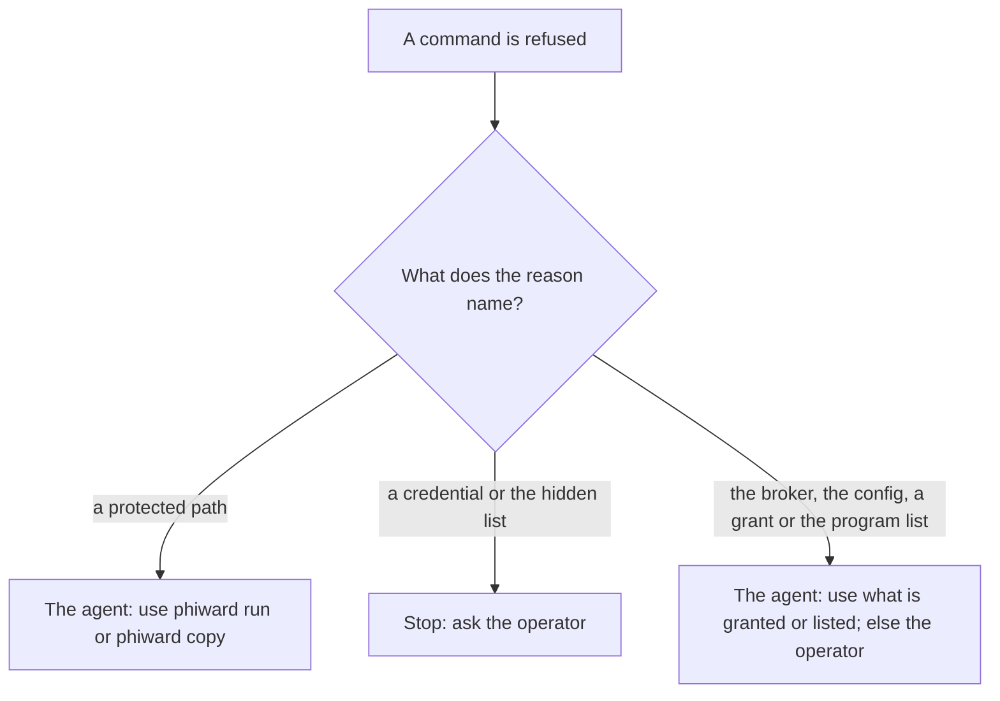

# Daily use

- **For:** you, the operator, once phiward is set up.
- **You will have:** a way to work with the agent on protected data, and an answer for each
  refusal.

The setup is in the [quick start](quickstart.md). The agent's own rules are the ones
`phiward init` adds to your project's `AGENTS.md`
([the text](https://github.com/msk-access/phiward/blob/v0.2.0b1/src/phiward/data/agents-section.md)),
and the skill.

**How to ask the agent.** Ask for counts and summaries of protected data, and let the agent run
them through the gateway: for example "count the reads per sample in the protected folder with
`phiward run`". The output comes back masked. Do not ask it to show records.

## Before the agent starts

1. The broker runs outside the agent: in a terminal of its own (`phiward broker`), or as a login
   service (`(cd ~ && phiward broker --service --write)`, once).
2. `phiward doctor` in the project's top folder shows no PROBLEM or WARNING line.

## Work with protected data: `phiward run`

```bash
phiward run -- samtools flagstat ~/data/patients/study-a/run1.bam
```

`run` is a client. It sends the words of the command to the broker, which runs the command in
the gateway profile and sends back the sanitized output. The command:

- can read every protected root;
- can write only in its private scratch folder (`$TMPDIR`) and in granted folders
  (`--write-to`, from `[broker] write_to`; with one granted folder, it is the default and needs
  no `--write-to`). Protected roots are read only for it; a granted folder may sit inside a
  root;
- has no network, unless `--net` is given and granted;
- has an empty stdin and no terminal;
- runs in the request's folder, with the broker's environment (not the agent's) and the program
  found on the broker's `PATH` (the `PATH` of the terminal that started the broker).

Every line it prints (stdout and stderr) goes through the sanitizer. A line longer than 64 KiB
is withheld. At the end, `run` prints a note (when it has something to say) and one line. The note counts the placeholders in the lines
shown, for example `[placeholders in the lines shown: 412 <SAMPLEID>, 60 <BAMFILE>]`, and the
lines the sanitizer withheld. From 20 shown lines on, when none holds an identifier placeholder
(a subject, a sample, a patient's folder, an entry or a protected path), it says so: tell the operator, who checks
`[sanitize] packs` and `patterns` with `phiward doctor`. Then `run done: exit=0`, or `exit=1` when the command failed.
The command's real exit status and the line counts go to the broker's log, which no session
reads (a number the command chooses could carry data).

**Write it as the whole command.** Nothing before or after it: no `cd`, no pipe, no redirect, no
`$(...)`. The shell may expand globs, braces and `~`. A gateway call in any other form is checked
as an ordinary command: Claude Code's sandbox denies the protected paths to it, and where the
sandbox does not confine the shell, the hook refuses it.

**Write scripts that print aggregates**: counts, summaries, tables. The sanitizer masks paths,
entry names and identifiers. It does not mask other content. In text mode it also masks long
numbers (`<NUM>`). `--table` reads CSV or TSV output by column: cells under an identifier header
(`sample_id`, `MRN`, `Patient ID`, ...) show `<IDCOL>`, and numbers in the other columns are
kept. It works only when the operator turned it on (`[sanitize] table = true`). One table per
output: print its header as the first line, and give it an identifier column. When the first
line is not such a header (a warning, a line of prose, a table with no identifier column), the
whole output is masked as text. The first line that is not a row of the table (an empty line, a
row with a quote or another field count, a row with no number, a second header) turns the rest
into text: print one table per command. Under `chrom` and `pos` columns, both cells are
shown (text mode masks `chr1 1234567` as one `<LOCUS>`).

Exit codes: 0 when the command succeeded, 1 when it failed (whatever its own code); 2 for a
refusal or a bad form; 3 for a config,
sanitizer, broker or confinement problem; 127 when the program cannot start; 130 when it was
cancelled.

Options (before `--`):

| Option | Effect |
|---|---|
| `--write-to DIR` | Also allow writes into DIR. DIR must resolve to a `[broker] write_to` folder of the user config, or a folder inside one. |
| `--net` | Allow the network. Needs `[broker] net = true` in the user config. |
| `--names-from FILE` | Also mask the names in FILE, an index file: tab-separated fields, where each field with a `/` is a path whose parts are masked (see [configuration.md](configuration.md#sanitize)). Not a link, and inside a protected path. |
| `--table` | Read CSV/TSV output by column: cells under an identifier header are masked whole (`<IDCOL>`), numbers in other columns are kept; other lines are masked as text. Only when the operator set `[sanitize] table = true`. |

Nothing asks the operator for a grant. A grant that is not in the user config is refused. The
agent tool's permission mode does not change this.

A gateway command cannot read credentials or traces either: the same list that `launch` hides
(`~/.ssh`, `~/.aws`, Kerberos tickets and keytabs, histories, other tools' logins, …). A command
that needs one is not one for the gateway. This includes settings files that may hold a token:
`~/.Renviron` (R libraries set there are not found), pip and npm settings, `~/.m2/settings.xml`,
`~/.ipython`, `~/.gnupg`. Pass what a script needs as arguments, or set it in the script. On
Linux the list is taken when the command starts: a credential made later is not hidden.

## Run a script the agent wrote

With choice 1 of `phiward setup`, gateway commands run only the listed programs: the
`@genomics` tools, and the scripts in your scripts folder (the entry that ends in `/` in
`[broker] commands`). So `phiward run -- python3 summarize.py` is refused: `python3` is not
listed, because it runs any code. To use a script that the agent writes:

1. The agent drafts the script in the project, for example `summarize.py`, and tries it on
   made-up data.
2. You read it. It must print only aggregates (counts, summaries, tables), never records,
   sample names or identifiers. **Your reading is what keeps raw records out of the output**:
   the sanitizer masks names and identifiers, not other content.
3. Add a shebang as its first line (for example `#!/usr/bin/env python3`), and make it
   executable: `chmod +x summarize.py`.
4. Move it into your scripts folder, for example `mv summarize.py ~/pipelines/bin/`. The agent
   cannot write there, so it cannot change the script after you read it.
5. In your own terminal, run `phiward pin`: it approves the programs as they are now.
6. Restart the broker; `pin` prints the command: `(cd ~ && phiward broker --service --write)`.

Then the agent runs the script by its full path (the shell expands `~`):

```bash
phiward run -- ~/pipelines/bin/summarize.py ~/data/patients/study-a
```

A changed script needs steps 2, 5 and 6 again. Until then, the broker refuses gateway requests,
and `phiward doctor` names the program that is not approved. No scripts folder yet? Run
`(cd ~ && phiward setup)` again, choose 1, and give one (keep it outside the projects the agent works
in).

## Copy protected data: `phiward copy`

A copy never replaces a file that exists at the destination: it keeps it. To update a file,
delete it yourself first.

```bash
phiward copy ~/data/patients/run1 ~/data/patients/run1-copy
```

`copy SRC... DST` copies without printing names. The destination must be inside a protected path
of the user config, or under a `[copy] remotes` entry. Each local path is made absolute
once, and every check and the copy itself use that path. One with a `..` part, or one that
starts with `~` (quoted, so the shell left it), is refused: give the full path. A local copy uses the system `rsync -a`
(or `cp -R`). A copy to or from a remote is a tar stream through your shared SSH connection
([hpc.md](hpc.md#phiward-copy)). The copy runs in the gateway profile and cannot read
credentials. Its output is sanitized. The only option is `--dry-run`, as the first word: it
counts what a push would send, and for a local copy it shows what rsync would copy.

## Give the agent pseudonymized data: `phiward pseudonymize`

When the agent needs a table but not its identifiers, make a copy in which the identifier
columns hold codes. Type the command yourself, in your own terminal:

```bash
phiward pseudonymize --new-key labs --columns mrn --drop dob ~/raw/labs.tsv ~/data/patients/labs-coded.tsv
```

- `--new-key NAME` starts a key; `--key NAME` extends it, so the same ID gets the same code in
  every table coded with that key. `--prefix P` (1 to 3 capital letters, default `S`) is fixed
  in a new key. A code is the prefix and 4 digits (`S0042`), drawn at random from the codes not
  used yet: a key holds at most 9999 IDs.
- `--columns H[=NEW],...` names the columns to code. A coded column's header becomes `NEW`
  (default `pseudonym`, then `pseudonym_2`, ...). Every other column whose header looks like an
  identifier (the built-in list of `phiward run --table` and `[sanitize] id_columns`) must be
  named in `--drop` (left out) or `--keep` (kept as it is, on your word).
- The kinds: the extensions decide, and the content must fit them. OUT has the same
  extensions as IN (`labs.tsv.gz` gives a `.tsv.gz`).
  - `.tsv`, `.csv`; `.txt` is read as a TSV and needs 2 or more columns (free text is refused).
  - `.maf`: a TSV after its `#` lines. Only the first `#version` line with a number
    (`#version 2.4`) is kept; the other `#` lines (commands, paths) are dropped, and a `#` line after the header is refused. Name
    the barcode columns, and keep the columns that look like IDs but are not:

    ```bash
    phiward pseudonymize --new-key samples --columns Tumor_Sample_Barcode,Matched_Norm_Sample_Barcode \
      --keep Entrez_Gene_Id,Exon_Number ~/raw/cohort.maf ~/data/patients/cohort-coded.maf
    ```

    The command names each column that looks like an ID and is not named (by number): add it
    to `--keep`, or to `--drop` (`Tumor_Sample_UUID`).

    A coded MAF column keeps its header, so MAF tools still read the copy. Tumor and normal
    get unrelated codes. A free-text column (`BAM_File`) that names a sample is refused: drop it.
  - `.vcf`: the first line is `##fileformat=VCFv4.N`. The IDs are the sample names after
    `FORMAT`, all coded, so give no `--columns`, `--drop` or `--keep`:

    ```bash
    phiward pseudonymize --new-key samples ~/raw/calls.vcf.gz ~/data/patients/calls-coded.vcf.gz
    ```

    - Of the `##` lines only `fileformat`, `INFO`, `FORMAT`, `FILTER` and `ALT` are kept,
      and `contig` with its `ID` only (`##contig=<ID=chr1>`). The others are dropped:
      `reference`, `source`, `fileDate`, the command lines, `SAMPLE`, `PEDIGREE`. A kept line
      the sanitizer would mask is refused.
    - A sample name that is a word (`tumor`, `normal`, `sample`, `sample1`, `control`,
      `germline`, `blood`, `unknown`, `na`, `none`, in any case), has no digit or is under 3
      characters is refused (also in another letter case or Unicode form, a full-width
      `ｓａｍｐｌｅ1`): it would link unrelated subjects in the key. Rename it first
      (`bcftools reheader`), or keep it as it is by number: `--keep-samples 2` keeps the name
      of the second sample, out of the key, on your word. The only check of a kept name is
      that the sanitizer leaves it unchanged; a name it would mask is refused. A word with a
      digit (`TUMOR1`) is coded.
    - A short sample name of digits only (`123`) refuses every record that holds that number
      as a value: rename it first.
    - The records keep their order (`tabix` needs sorted positions) and their values. The
      sample columns are shuffled instead, the same in every record (`--keep-order` keeps
      them). A record or a kept line that holds a sample's ID (an `INFO` value, the `ID`
      column) is refused: clean it first (`bcftools annotate`).
    - The run reports the record count.
  - `.json`: the IDs are the values at the key paths you name. Keys are joined by `.`, and
    `[]` stands for every element of an array (`[].mrn` for an array at the top):

    ```bash
    phiward pseudonymize --new-key samples --columns 'samples[].id, samples[].mrn' \
      ~/raw/study.json ~/data/patients/study-coded.json
    ```

    - A key is matched exactly; a key with `.`, `[` or `]` cannot be named. A path that
      matches nothing, or meets a value of another kind (a key where there is no object), is
      refused.
    - A coded value is a string or an integer; it becomes a string code (`9990001` and
      `"9990001"` get the same code, as in a table). `null` stays `null`. A `true`, a decimal
      number, an object or an array at a coded path is refused.
    - Every key that looks like an identifier and holds values (strings, numbers, `true`,
      `false`, `null`) is named by their path in `--columns`, `--drop` or `--keep`:
      `samples[]` for strings in an array under `samples`, `samples[].id` for the `id` of its
      objects. A key that holds only objects or arrays (`samples` above) needs no name.
      `--keep` names such a path; `--drop` names a key, and drops a container whole. A key
      the sanitizer would mask is refused: keys that are IDs are not coded.
    - The array at the last `[]` of a coded path (`samples[]` for `samples[].id`, an array of
      objects) is shuffled. It is refused when an array of the same length sits beside it in
      the same object: arrays side by side may be paired by position (`samples` and
      `purity`), and a shuffle would break the pairing without a word. Give `--keep-order`
      (it is for the whole run, never one array), or drop the other array. A path that ends in
      `[]` (`ids[]`, the elements themselves) needs `--keep-order`: an array of IDs may be
      paired by position with arrays in other files. Other arrays and the order of keys are
      kept.
    - Refused as unreadable: a key twice in one object, `NaN`, `Infinity`, a number out of
      range (`1e400`), an integer of more than 4300 digits, nesting deeper than 100 levels, a
      lone surrogate (`\ud800`, which has no UTF-8 form).
    - Every key and every value of the copy is a field for the scan below; a number that is
      whole is also read as its integer (`1234.0`, `"9.990001e6"` for `9990001`). The copy is
      written with an indent of 2, and it must read back as the coded document. A message
      names a key by its number in the order of the file. The run reports no count.
  - Each of them gzip-compressed (`.tsv.gz`, `.maf.gz`, `.vcf.gz`, `.json.gz`, `.md.gz`). Every member is read, up to
    1 GiB expanded. The copy is plain gzip with no name and no time, and it must read back as
    the coded table before it is written. A bgzip (BGZF) input, every block of it, gives a
    BGZF copy; for a VCF, `tabix -p vcf OUT` indexes it. An index (`.tbi`, `.csi`) is never
    read or copied. A BGZF file must end with its EOF block (one cut short is refused), and a
    file that mixes BGZF blocks and plain gzip members is refused.
  - `.md`: the file holds only pipe tables and blank lines. The names of `--columns`,
    `--drop` and `--keep` apply to each table whose header holds them:

    ```bash
    phiward pseudonymize --new-key labs --columns mrn ~/raw/labs.md ~/data/patients/labs-coded.md
    ```

    - Each line of a table starts and ends with `|`, and the second line is the alignment row
      (`| --- | :---: |`). Any other line is free text and is refused: prose, a heading, a
      list, code, front matter, an HTML comment, a row without its outer pipes.
    - A line with a backslash or a backtick is refused: an escaped pipe (`\|`) or a code span
      has no safe split into cells. A line with `<`, `[` or `]` is refused: inline HTML,
      links, images and autolinks are not covered (write `&lt;` for a `<`). A header with
      emphasis or an entity (`**id**`, `_mrn_`, `patient&#95;id`) is refused: write it plain.
    - Two tables need a blank line between them: a row inside a table whose cells are all
      like `---` is refused (it would read as a second header, coded as IDs). So is a body
      row of dashes only (`| - | - |`).
    - Each table follows the table rules: every column that looks like an identifier is
      named, in that table. Each name is found in some table, and one ID gets one code in
      all of them.
    - The body rows of a table with a coded column are shuffled (`--keep-order` keeps them);
      the other tables keep their order. The header and the alignment row are kept. The copy
      is written as `| a | b |` lines, one blank line between tables, and read back.
    - For the scan, every cell is also read with its HTML entities decoded (`&#45;`,
      `&amp;#45;`, `&hyphen;`, also nested up to 4 times; deeper is refused) and its
      emphasis marks removed (`**`, `_`, `~~`): `&#70;AKE-PT-0001` and `999**0001**` are
      found. A message names a table by its number. The run reports the row count of all
      tables.
  - Not covered: Parquet; convert it to TSV with your own tools first.
  - A file that cannot be read or written as its kind gives one fixed refusal.
- The rows are shuffled, so a file sorted by MRN does not give away the order of the IDs.
  `--keep-order` keeps the order.
- The home folder itself is not a project (your `~/.claude` is Claude Code's own folder), so
  an input in a folder of your home is taken; one below a project inside it is not.
- The input is one table of those kinds (UTF-8, every row as wide as the header), reached with
  no link, outside every place an agent can write: the working folder and its git work tree,
  any project (a folder with `.git`, `.claude` or `.phiward.toml` above the input), the temp
  folders, the sandbox's `allowWrite` and `additionalDirectories`,
  a `write_to` folder, the spool and `~/.phiward`. No field of the output (a cell, a header, the
  kept `#version` line, the codes too) may hold an ID of a coded column or of the key, also in
  another letter case, Unicode form, dash (`‐`, `–`, `−` and the other Unicode dashes) or
  script of digits, or escaped (`%2D`, `\u002D`, `%E2%80%90`, also escaped twice): an ID of
  5 or more characters anywhere in a field, or across the fields of a line as written (`Doe,
  John` as the CSV fields `Doe` and ` John`), and one with a letter also with every
  character but letters and digits removed (`FAKE PT 0001`, `FAKE.PT.0001`,
  `FAKE-**PT**-0001` for `FAKE-PT-0001`; digits are never joined, so `999 0001` is not
  `9990001`); one of 5 or more digits as a whole run of digits, so
  `see 9990002` refuses and `19990001` does not; a shorter one with a letter as a whole word;
  a shorter one of digits only as the whole field. No field may hold an invisible format
  character. Not found: a short digit ID
  inside a cell (`12` in `12 mg`), an ID glued to other digits (`19990001`), an ID written
  another way (with spaces or other hyphens, `9 990 001`), an ID with its leading zeros
  dropped or added (`0001` and `1`). Check such columns yourself, or drop them. Two IDs
  that differ only in letter case or Unicode form (`P-1`, `p-1`, a full-width `Ｐ-1`), in
  the input or in the input and the key, are refused: make them one first. The output is a new file of the same kind inside a protected root of your user
  config, outside every `write_to` folder. It is never replaced. The agent reads it through `phiward run`, masked; the codes pass the masks.
- The key is `~/.phiward/backups/keys/NAME.tsv`. No session, launch or gateway command can read
  or write it. It is only ever added to. `phiward install claude` makes `~/.phiward/backups`;
  until then the command refuses. Keep a backup of the key where no agent can reach it: a lost
  key cannot be rebuilt, and new runs give new codes.
- The command refuses without a terminal, and the hook refuses it as an agent command. Its
  messages name no value, header or path, and a run reports only the row count.

Never run it on a file the agent made or asked for, wherever it is, or with a key name the
agent chose: the codes it gives would confirm the IDs the agent guessed. A file inside a
protected root may have been put there by `phiward copy` at the agent's request; the command
cannot tell. Run it from the folder of the project whose agent will read the copy: the
places it refuses come from that project's sandbox settings (and the user's). Run it in a terminal the agent's app
cannot read (not the app's own terminal panel): the command line you type, with its paths and
headers, stays in the terminal's scrollback. What the codes do not hide is in
[threat-model.md](threat-model.md#known-limits).

## Check a command: `phiward check`

```bash
phiward check -- cat ~/data/patients/file.txt
```

`check` prints the hook's decision for a shell command in the current folder (`allow`, `ask` or
`deny`) and the reason. The exit code is 0, 1 or 2. `--cwd DIR` before `--` checks from another
folder. `check` answers as if the command ran in Claude Code's sandbox. Where the shell is not
confined, the hook refuses every command but a whole gateway call, whatever `check` says. It joins its words with spaces, so quoting in the command is lost.

## Filter your own output: `phiward sanitize`

```bash
some-producer 2>&1 | phiward sanitize
```

`sanitize` masks each line from stdin to stdout, with a `sanitizer on:` line before and a
`sanitizer done:` line after. It does not list the roots, so it does not mask entry names
(`<ENTRY>`); `run` does. Use it for output you share outside the agent. Options: `--table`,
`--names-from FILE`, `--check FILE` and `--check-table FILE` (report whether a file would
change), and `--selftest` (run the built-in test lines). `--table` and `--check-table` need
`[sanitize] table = true`, read from the caller's own config: in this form that is a
convenience, not a guard. Here `--table` reads no columns: each line is masked for identifiers
only, and numbers and positions are kept. The hook does not accept this pipe form as a way to read protected
data: use `phiward run`.

## When a command is refused

A refusal is a decision, not a fault. The reason says what to run instead. The agent must not
try another spelling, a link, a nested shell, an encoded command or another tool to reach the
same data. It also does not ask you to show it the data (`! cat`, a paste, a copy into the project)
or to remove a guard. If it does, say no: that sends the data to the model provider.

Who acts on a refusal:



### Refusals from the hook

The hook refuses a tool call that names a protected path, and ends its reason with the rule:
no tool may read, list, search or print a protected path; use `phiward run -- CMD` as the
whole command, or `phiward copy`. Once a config exists, it also refuses `phiward setup`,
`broker`, `pin` and `carryover`: those are for the operator only.

### Messages from `run` and `copy`

Messages start with `run` or `copy` (the table shows `run`; `copy` says the same), and the real
text goes on with more detail. Four come from the broker itself and start with `refused:`
(busy; cannot use this request; the config changed; programs not approved); all four exit with
3. An exit of 3 with no output at all means the broker refused the request before it could write
anything: the broker's log has the reason.

| Message | Meaning | What to do |
|---|---|---|
| `[... no identifier placeholder in the N lines shown ...]` | 20 or more lines were shown and no rule masked a subject, a sample or a protected name in them. | If the data names subjects or samples, the operator checks `[sanitize] packs` and `patterns` (`phiward doctor`). |
| `run refused: no phiward broker is running` | No broker, or its heartbeat is older than 10 s. | The operator starts the broker: `phiward broker` in a terminal, or the login service ([setup.md §5](setup.md#5-start-the-broker)). |
| `run refused: the request could not be written to the broker's spool folder` | The client cannot write the spool. | The operator adds the spool folder to the tool's sandbox `allowWrite` (`phiward install claude` does it). |
| `run refused: the phiward config cannot be used` | A bad config. | The operator runs `phiward doctor` (with `--show-paths` for a repo config, in their own terminal) and fixes the file. |
| `run refused: this program is not in [broker] commands of the config` | The operator lists the programs gateway commands may run. | Use a listed program, or ask the operator to add yours; they restart the broker after. For a script the agent wrote, see [above](#run-a-script-the-agent-wrote). |
| `run refused: no protected paths are configured` | The operator has not set phiward up yet. | The operator runs `cd ~ && phiward setup` in their own terminal. |
| `run refused: --write-to names a folder that is not granted` | DIR is not a `[broker] write_to` folder or inside one (or is a link to somewhere else). | Use a granted folder, or ask the operator to add one. |
| `run refused: --net is not granted` | `[broker] net` is not true. | Work without the network, or ask the operator. |
| `run refused: the program is not on the broker's PATH` | The program is found neither on the broker's `PATH` nor as an executable path. | Give the full path of the program (when a program list is set, only a program listed by its path or folder). Or the operator starts the broker again from a terminal where the program works (for example after `conda activate`). |
| `run refused: a write place is no longer a real folder` | A link was put on the path of a granted folder after it was checked. | The operator checks that folder. |
| `run failed: the command could not start` | The program could not be started. | Check the program and its path. |
| `copy refused: ... not under a configured remote` | A remote source or destination is not a `[copy] remotes` entry. | Ask the operator to add the remote. |
| `copy refused: start your shared connection first …` | The shared SSH connection to the host is not running. | The operator runs `kinit`, then `ssh -fN HOST`. |
| `refused: the broker cannot use this request (...)` | The request was malformed, or its folder does not exist. | Run the command again from an existing folder. |
| ``copy refused: a local path holds `..` or starts with `~` `` | A local source or destination was written with `..` or a quoted `~`. | Give the full path. |
| `copy refused: options are not accepted` | `copy` picks its own options. | Remove the options (only `--dry-run` first is allowed). |
| `refused: the broker is busy` | Too many requests wait. | Try again later. |
| `refused: the phiward config changed since the broker started` | The config, the approved programs or a names file changed while the broker ran. | The operator reads the change and restarts the broker. |
| `refused: N program(s) of [broker] commands differ from what the operator approved` | A listed program changed, is new, cannot be read or is a link. | The operator runs `phiward doctor`, checks the programs, runs `phiward pin` and restarts the broker. |
| `run refused: the sanitizer cannot start` | A pack, a names file or the entry limit is wrong. | The operator runs `phiward doctor`. |
| `copy refused: the destination is not under [remote] roots of the user config ...` | A push goes only under a remote root, where remote output is masked. | Ask the operator to add the folder to `[remote] roots` (`phiward setup` does it). |
| `copy refused: the destination is not inside a protected path of the user config` | A copy may not leave the protected folders. | Copy into a protected folder, or to a configured remote. |
| `run stopped: cancelled` | The client was interrupted (Ctrl-C); the broker stopped the command. | None. |
| `run stopped: the broker stopped before the command finished` | The broker went away. | The operator restarts it. |

## Troubleshooting

- **`doctor` says the sandbox does not confine the shell.** The reason follows. The usual ones:
  a root is missing from `denyRead` or `denyWrite` (run
  `(cd ~ && phiward install claude --user --write)` again after a config change), `excludedCommands` is not empty, a unix socket is allowed, an
  `allowRead` entry re-opens a root, or patterns are configured. (Inside Claude Code, the hook
  also needs `$CLAUDE_PROJECT_DIR`; Claude Code sets it.) The hook then refuses shell commands
  other than gateway calls, `doctor` and `check`. With `[shell] best_effort` on,
  the hook checks shell command text instead, which is best effort
  ([configuration.md](configuration.md#shell)).
- **`doctor` says the broker uses another config.** The broker and the agent tool were started
  with a different `HOME`, `PHIWARD_CONFIG` or `XDG_*` variable. Start both from the same
  environment.
- **A write place is skipped.** `doctor` says why: it does not exist yet, or a link is on its
  path. Name the real folder in `write_to`.
- **A gateway command fails to write to `/tmp`.** The gateway sees `/tmp` read-only. It writes
  temporary files to `$TMPDIR`, its private scratch folder.
- **git does not work in a repository.** A protected root sits in that work tree, so its `.git`
  is protected. Move the data out of the repository.
- **Every shell command fails after an upgrade.** An older phiward's shell prefix is still set:
  run `(cd ~ && phiward install claude --user --write)` again (`doctor` warns about it).
