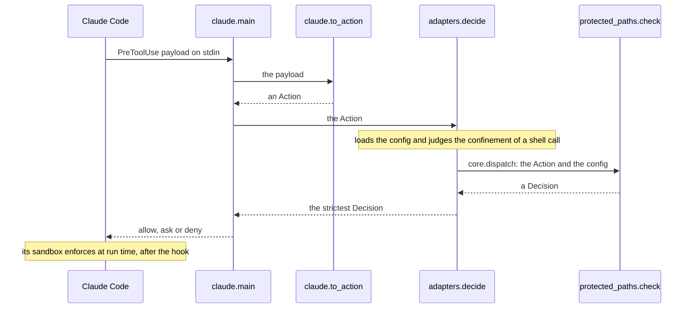
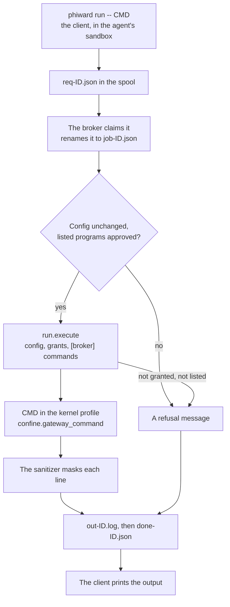

# For contributors: how phiward decides

- **For:** a contributor who changes phiward's own code.
- **Before:** a checkout of the repository, `python3` 3.9 or newer, and
  [uv](https://docs.astral.sh/uv/) for the tests.
- **You will have:** a working setup that touches nothing of your own, and a picture of how a
  decision is made.

phiward keeps protected health information (PHI), and the credentials that would reach it, out
of what an AI coding agent sends to its model provider. The rules for a change are in
[CONTRIBUTING.md][contributing] and [AGENTS.md][agents]. This page does not repeat them.

## The first half hour

**Work beside your own setup, never in it.** You may use phiward for real work, with a real
config and a running broker. Three variables point a checkout away from them. The tests set the
same ones (`tests/conftest.py`).

Open a new terminal in the checkout, and close it when you are done:

```bash
SCRATCH="$(cd "$(mktemp -d)" && pwd -P)"
mkdir -p "$SCRATCH/fakehome" "$SCRATCH/phi" "$SCRATCH/repo"
echo SECRET-CONTENT-0001 > "$SCRATCH/phi/FAKE-PT-0001.bam"
printf '[protected_paths]\nroots = ["%s/phi"]\n' "$SCRATCH" > "$SCRATCH/fakehome/phiward.toml"
export HOME="$SCRATCH/fakehome" PHIWARD_CONFIG="$SCRATCH/fakehome/phiward.toml"
export PHIWARD_SPOOL="$SCRATCH/spool" PYTHONPATH="$PWD/src"
python3 -m phiward doctor
```

- `HOME` is a scratch home. `PHIWARD_CONFIG` names a made-up user config. `PHIWARD_SPOOL` names
  a scratch spool. `doctor` must name your scratch config, not your real one.
- Never run `setup`, `install`, `pin`, `carryover` or `broker --service` against your real
  home. Never run the real `claude` in an experiment.
- `python3 -m phiward broker` in this terminal is a scratch broker. A second terminal, with the
  same `SCRATCH` and the same exports, can then send it `python3 -m phiward run -- CMD`. Do not
  type a bare `phiward` here: that is your installed release, not the checkout. `launch` refuses
  a checkout unless `PHIWARD_DEV=1` is set.

**Run the tests** in a normal terminal (they make their own scratch home). The command, and how
to run a part of the suite, are in [tests/README.md][tests]. For one file, add its path:
`tests/test_protected_paths.py`.

**Try a decision by hand.** `check` shows the decision for a shell command. Nothing runs:

```bash
python3 -m phiward check --cwd "$SCRATCH/repo" -- cat "$SCRATCH/phi/FAKE-PT-0001.bam"
```

It prints `deny:` and the reason. The exit status is 0 for allow, 1 for ask and 2 for deny.
`check` judges the command as if Claude Code's sandbox confined it.

The hook itself reads a payload on stdin. Feed it a made-up one:

```bash
printf '{"tool_name":"Read","tool_input":{"file_path":"%s/phi/FAKE-PT-0001.bam"},"cwd":"%s/repo","permission_mode":"default"}' \
  "$SCRATCH" "$SCRATCH" | python3 -m phiward hook claude; echo "exit=$?"
```

| Reply | Meaning |
|---|---|
| exit 0, no output | allow |
| exit 0, a JSON object with `"permissionDecision": "ask"` on stdout | ask: Claude Code shows a prompt |
| exit 2, `phiward [protected-paths]: ...` on stderr | deny, with the reason |
| exit 2, `phiward: the hook could not decide ...` on stderr | a fault: it is refused too |

The payload above is denied. With `"tool_name":"Write"` and the path
`$SCRATCH/repo/.vscode/tasks.json` you get the ask. A `Bash` payload is refused here: a hand-made
payload has no `$CLAUDE_PROJECT_DIR`, and no settings in the scratch home confine the shell.

## What the agent controls, and what phiward trusts

| The agent controls (never trusted) | Trusted (the operator's) |
|---|---|
| the hook payload, its `cwd` included | the user config, and `pinned.toml` next to it |
| the project folder, and a repo `.phiward.toml` in it | the other guard files (`config.guard_files`): the broker's status file, phiward's own install |
| the temp folders | the broker, and the environment it builds for a command |
| every file in the spool | the operating system's sandbox |
| the words and the folder of a gateway request | Claude Code's sandbox and permission rules (Mode A) |

A repo `.phiward.toml` can only add protection. Everything that widens the gateway comes from
the user config ([configuration.md](configuration.md#who-may-set-what)).

**The invariants.** Each one has a place in the code:

- **Fail closed.** A guard that raises denies (`core.dispatch`). A hook fault exits 2
  (`adapters/claude.main`). A config that cannot be used refuses what it guards.
- **The strictest answer wins:** deny over ask over allow (`core.strictest`). An ask that the
  tool cannot show becomes a deny (`core.settle`).
- **A new check only adds refusals.** It never changes what kind of action a tool is, and never
  turns a refusal into an ask ([review-rounds.md][rounds]).
- **What is checked is what starts.** The gateway runs the entry of the user config's list, not
  a path the agent names (`run.listed_run_path`). `pin` records each listed program by its
  content. The broker refuses every request when the config or a listed program changed since
  it started (`broker.config_print`).
- **Nothing asks the operator at run time.** Grants come from the user config only.
- **Made-up data only**, in tests and in experiments (`FAKE-PT-0001`).

## One tool call

Claude Code runs `phiward hook claude` before each tool call (Mode A).



1. **`adapters/claude.to_action`** turns the payload into an `Action` (`core.py`): the kind
   (shell, file read, file search, file write, other), the folder, the command or the paths,
   and whether the session can show an ask. No policy lives here.
2. **`adapters.decide`** loads the config for the action's folder. For a call of Claude Code's
   own shell tools, it checks that Claude Code's settings confine the shell. This is where the
   sandbox comes in: the hook does not run the sandbox. It records `confined` on the `Action`,
   or the reason why not.
3. **`core.dispatch`** runs every guard and keeps the strictest decision. Today there is one
   guard, `guards/protected_paths.check`.
4. **`check`** judges the action by its kind. Read the function for the order of its checks:
   the order changes, and each step says why it is where it is.
5. **`claude.main`** writes the reply of the table above.

Under `phiward launch` (Mode B) the kernel decides. The hook there is a quick first layer
(`fasthook.py`).

## One gateway request

`phiward run -- CMD` is a client only. The broker runs the command, outside the agent.



- The request holds the words and the folder, and no environment. The broker builds the
  command's environment from a short list of its own variables (`broker.command_env`).
- The broker treats every file in the spool as untrusted data (the top of `broker.py` says how).
- `run.execute` loads the user config plus the repo config of the request's folder. It checks
  the grants (`--write-to`, `--net`) and `[broker] commands`.
- `run.run_confined` starts the command in the profile that `confine.py` builds. The command
  reads the protected roots. It writes only its scratch folder and the granted folders. It has
  no network unless granted.
- Every line goes through `sanitize.Sanitizer`. Masking hides names and identifiers, not other
  content. With `--table`, `sanitize.Columns` reads the lines by column (fresh for each call).
- The agent sees `exit=0` or `exit=1` only, and a note that counts the placeholders in the
  lines shown (`run_confined`). The real exit status and the counts go to the broker's log.
- `phiward copy` and `phiward run --remote` take the same road (`copying.execute`,
  `run._execute_remote`).

## Change this, change that too

| You change | Change these too |
|---|---|
| a guard's rule | its red test first; [threat-model.md](threat-model.md); the help text and the refusal message |
| a config key | `config.py` `SCHEMA` and the tighten-only rule; [configuration.md](configuration.md) (both tables); `setup_cmd.py` when `setup` should write it |
| a hidden path | `hidden.py` only: the hook, `install`, `launch` and the gateway read it. The list in [modes.md](modes.md). `install` then writes new rules, and the hook refuses the shell until they are in place: say in the changelog that users wire again |
| a tool name (a new Claude Code tool) | the tool sets at the top of `adapters/claude.py`, and `to_action` |
| a message the user sees | the table in [daily-use.md](daily-use.md#when-a-command-is-refused); `tests/test_v2_refusal_words.py` |
| a help text | `USAGE` in `cli.py` and the module's own `HELP` |
| a new test file | the index in [tests/README.md][tests] (a test checks it) |

## Next

- How a change is planned and reviewed: [review-rounds.md][rounds].
- The module map: [architecture.md][arch].
- Which test files cover which feature: [tests/README.md][tests].
- Ideas that were turned down already: [decisions.md][decisions].

[contributing]: https://github.com/msk-access/phiward/blob/v0.2.0b1/CONTRIBUTING.md
[agents]: https://github.com/msk-access/phiward/blob/v0.2.0b1/AGENTS.md
[rounds]: https://github.com/msk-access/phiward/blob/v0.2.0b1/.agents/rules/review-rounds.md
[arch]: https://github.com/msk-access/phiward/blob/v0.2.0b1/.agents/rules/architecture.md
[tests]: https://github.com/msk-access/phiward/blob/v0.2.0b1/tests/README.md
[decisions]: https://github.com/msk-access/phiward/blob/v0.2.0b1/.agents/decisions.md
