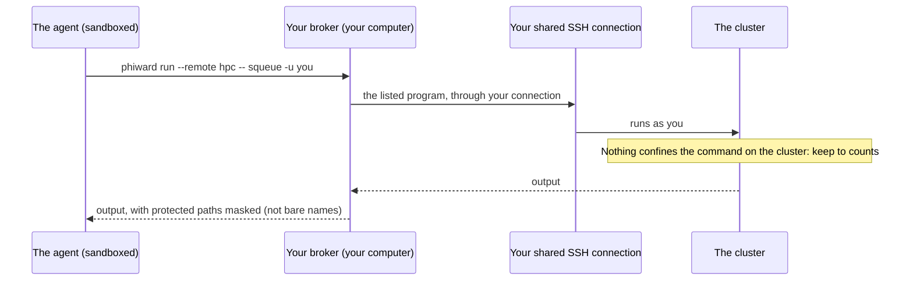

# HPC: Kerberos, mounts, `copy` and `run --remote`

- **For:** people whose agent runs on their own computer (a Mac in the examples), in a Claude Code
  session (Mode A) or under `phiward launch` (Mode B), and who reach an HPC cluster with a
  Kerberos ticket and a shared SSH connection (`kinit`, then `ssh -fN`).
- **You will have:** the agent working with HPC through the gateway, with masked output.

**Use one host name everywhere:** the `Host` in your `~/.ssh/config`, the `Host` in phiward's
ssh config, `[remote] hosts`, and the host part of `[copy] remotes`. `ControlPath ~/.ssh/cm-%C`
matches only when `HostName`, `User` and `Port` are the same in both ssh configs.

**The rule:** the agent may work with HPC, but protected data reaches the model only masked.
Hence two paths:

| Path | Who holds your ticket and SSH connection | What comes back to the model |
|---|---|---|
| The agent's own shell (`ssh cluster cat …`) | nobody: it fails, because the sandbox (Mode A: Claude Code's; Mode B: phiward's) hides your keys, config and connection socket. With phiward's hook alone and no sandbox it would not fail. | nothing |
| The gateway (`phiward copy`, `phiward run --remote`) | your broker, outside the sandbox | masked output |

How a remote run goes:



## One-time setup

The easy way: `phiward setup`, answer yes to the HPC question, and give the cluster's short
name, login host, your user name and your work folder. It writes phiward's ssh config and the
`[copy]` and `[remote]` settings, and prints the lines for your `~/.ssh/config`. Then do step 4
below. The steps by hand, which do the same:

Use one host name everywhere below (here `hpc`).

1. In `~/.ssh/config`, add these lines to your existing entry for host `hpc` (keep its
   `HostName`, `User` and `GSSAPIAuthentication` lines):

   ```
     ControlMaster auto
     ControlPath ~/.ssh/cm-%C
     ControlPersist 8h
   ```

2. Write phiward's own ssh config, `~/.config/phiward/ssh_config`, with the **same** `Host`,
   `HostName`, `User` and `ControlPath`, and `ControlMaster no`:

   ```
   Host hpc
     HostName <login host>
     User <you>
     ControlPath ~/.ssh/cm-%C
     ControlMaster no
   ```

   `%C` stands for the host, user and port, so they must be the same in both files.
3. Edit `~/.config/phiward/config.toml`.
   - In the `[copy]` section, add `ssh_config = "~/.config/phiward/ssh_config"`, and make sure
     `remotes` holds your HPC work folder. `setup` may have made this section already: **do not
     add a second `[copy]` section**; a second one makes the file invalid.
   - Add a `[remote]` section at the end:

   ```toml
   [remote]
   hosts = ["hpc"]
   commands = ["squeue", "sacct", "sinfo"]
   roots = ["/data/protected"]
   ```

   Then run `phiward doctor`: a mistake in the file shows as a `PROBLEM`. If the broker runs
   already, restart it: it refuses requests after the config changes, until you do
   ([setup.md](setup.md#change-the-setup)).
4. Before each session that uses HPC, in Terminal:

   ```bash
   kinit you@REALM
   ```

   ```bash
   ssh -fN hpc
   ```

5. Test it:

   ```bash
   phiward run --remote hpc -- squeue -u you
   ```

The sections below explain what each part does and allows.

## What the session can never use

- your Kerberos ticket caches **that are files**: the file `KRB5CCNAME` names, `krb5cc*` files in
  `/tmp`, `/var/tmp` and the macOS per-user temp folder, and `/run/user/<uid>` on Linux. A cache
  kept by the macOS credential service (`API:`, the default when `KRB5CCNAME` is not set) or by
  the Linux keyring or KCM is not a file; Mode B blocks the Linux keyring, and `doctor` warns
  when your cache is not a file ([modes.md](modes.md));
- `~/.ssh` (keys, config, known hosts), the SSH agent, and the socket of your shared connection
  (outside unix sockets are refused).

## Mounted HPC storage

Put the **mount path** of protected HPC folders in your protected roots (for example the folder
where the cluster's protected storage is mounted on your Mac), with `phiward setup` or in the user
config. On Linux, phiward also protects other mounts of the same data that it can see (alias
mounts). **On macOS it does not detect them:** list every mount path of the data as a root. `phiward run -- CMD` on that data runs through the broker, with masked output.

## Your shared connection holds the login

Every request to HPC (a copy to or from a remote, `run --remote`) goes through **your shared SSH
connection**. You start it; phiward's ssh joins it through its control socket, which needs no key
and no ticket. So:
- no request can read `~/.ssh` (keys, config, known hosts), a ticket cache or a keytab;
- a request has **no network** except that one socket, and only the system `ssh`, with options
  phiward fixes (no forwarding of any kind), ever talks to it;
- if the connection is not running, the request is refused with a message. phiward never logs in
  by itself.

The socket carries your full login: a program that could speak ssh's protocol on it could ask
your connection for forwarding or new channels. That is why nothing but the system ssh touches
it (rsync does not), and why phiward trusts a socket only when it is yours, is not a link, and
lies under `~/.ssh` (or `/run/user/<uid>`) in folders that only you can write: a socket the agent
made first somewhere else is refused. On Linux a request also gets fresh, empty `/tmp`, `/var/tmp` and
home folders, so the sockets there are out of reach; a socket in another folder you can write
(for example `/scratch`) that was renamed after it was made is not, but only ssh runs there.
Files your ssh config `Include`s from your home are not visible to it on Linux.

Keep phiward's ssh config outside `~/.ssh`. Its `ControlPath` must be under `~/.ssh`
(setup step 2).

`[remote] use_shared_connection = false` turns this off: ssh then logs in itself, so a request
can read your key or ticket and has the network. The agent still cannot choose ssh's options or
the paths, but a bug in ssh or rsync that the other end exploits could then reach a credential.

## `phiward copy`

`phiward copy SRC... DST` copies without printing names. The destination must be inside one
of your protected roots (by its real path, with no link on the way, and not a pattern match or a
`.claude` folder), or under a remote you approved in the user config. A `.claude` folder is
never copied:

```toml
[copy]
remotes = ["hpc:/work/yourname/project"]
ssh_config = "~/.config/phiward/ssh_config"
push_limit_gib = 5        # a larger push is yours to do (default 5)
```

A remote must name a **work folder** on the cluster: not `/`, not a folder just below it
(`/home`, `/data`), not a home folder (a folder named `home`, `home1`, `homes` or `users`, or
one just inside it, wherever it is: `/home/you`, `/gpfs/home/you`), and not inside a dot-folder
(`.ssh`, `.config`). `setup` refuses these, and `copy` ignores such a remote. A copy never goes
into a dot-folder either. A push to your home folder could otherwise plant your login files
there; if your cluster names home folders another way, name a work folder yourself.

Copies may go:
- from an unprotected folder (the project) to an approved remote, under a `[remote] roots`
  folder;
- from a protected folder to a protected folder or to an approved remote, under a `[remote]
  roots` folder;
- from an approved remote to a protected folder.

Give local paths in full: a local path with a `..` part, or one that starts with a quoted `~`,
is refused. A push goes only under a `[remote] roots` folder, where remote output is masked;
with no remote root, every push is refused (setup makes each new copy remote's folder one). Locally,
what lands is inside a protected root. On the cluster it is masked only under `[remote] roots`,
and a link there can carry a push outside one.

**A push** (local sources to a remote) does not use rsync. A source may be any file or folder
that is not a credential, not above one, and not in `/dev`, `/proc` or `/sys`. Your broker checks each source,
resolves it once, opens it without following links, and sends what it reads as a tar stream to
`tar -x` in the remote folder (made if missing). So:
- a link put on a source path after the check makes the push stop; nothing behind it is sent;
- links, special files and files with a second name (hard links) inside a source are skipped and
  counted, never followed;
- files that a shell, ssh or a tool reads at login or when you enter a folder are skipped and
  counted, at any depth: `.ssh`, `.bashrc`, `.profile`, `.zshrc`, `.gitconfig`, `.envrc`,
  `.config`, `.local`, `.ipython`, `.Rprofile` and similar; and every name that starts with `.`
  at the top of the destination. Copy them yourself if you need them there;
- the remote side cannot ask for anything: the stream goes one way;
- `src` lands as `DEST/src`, `src/` and `src/.` land as its contents; the destination is a
  folder;
- every push sends everything named (no resume), but **files that exist on the cluster are
  kept, never replaced**, and pushed files arrive without the executable bit (`0644`; folders
  `0755`): an agent cannot replace a job script you run later. To update a file there, delete
  it yourself first, or `chmod +x` a script you pushed;
- over `push_limit_gib`, the push is refused: copy it yourself.

The result is counts (`copy sent: files=N folders=N skipped=N`) and whatever the remote side
prints, masked like `run --remote` output (your `[remote] roots` included).

**A pull** (remote sources to a protected folder) does not use rsync either: `tar -c` on the
remote streams through the shared connection into phiward's own extractor, a file in the
installed package (`phiward/tar_extract.py`, run by path with phiward's Python), in the gateway
profile. It writes only inside protected roots, reads no credential and has no network at all.
Every pull sends everything named (no resume); files that exist in the protected folder are
kept, never replaced. What the remote sends lands inside the protected
folder: plain files and folders only; links and special files are skipped. A file or folder
that cannot be made there (no permission, no space) fails the pull; the rest is still written.
A pull needs `mkdir` and `tar` in a system folder (`/usr/bin`, `/bin`, `/usr/sbin` or
`/sbin`); without them it is refused: install them with the system's package manager.

A remote path may hold only letters, digits and `. _ + - /`, so it is one plain word for the
remote shell. An argument with a `:` before its first `/` is remote, as rsync reads it: write a
local name with a `:` as `./name`. A source that is or holds a credential (`~/.ssh`, your home)
is refused. A copy between two remotes is refused.

## `phiward run --remote HOST -- CMD`

Your broker runs CMD on the host through your shared connection, and masks what comes back.

```toml
[remote]
hosts = ["cluster"]                     # hosts the agent may name
commands = ["squeue", "sacct", "sinfo", "wc", "du"]   # programs it may run there; empty = none
roots = ["/data/protected"]                # protected paths on the host, masked in the output
```

```bash
phiward run --remote cluster -- squeue -u yourname
```

- Only hosts in `[remote] hosts` and programs in `[remote] commands` are allowed. These keys
  come from your user config only; a repo config cannot set them. The program is one bare name.
  Every word reaches the remote shell quoted, so `;`, `$()` and the like are plain text there.
  A word with `!`, a newline or another control character is refused: a csh or tcsh login
  shell expands `!` even inside quotes.
- **Nothing confines the command on the cluster.** It runs as you. The list of commands is what
  limits its effects there. Each program you add is a decision: `sbatch` submits a job that can
  run anything, and `cat` or `head` print contents, which masking does not hide beyond names and
  identifiers.
- The output is masked like local gateway output: your protected roots, the names under them,
  identifier patterns, names files and packs, plus every path under `[remote] roots`, in its
  absolute spellings (`//`, `/./`). A word with a `..` part is refused. After a remote root, the rest of the path up to a
  tab or the end of the line is masked, since a name may hold spaces: put counts before paths
  (`wc`, `du` do). **Not covered:** a path relative to the remote folder (`../share/P1`), a
  remote link to a protected folder, and bare names (below).
- **Bare names are not masked.** phiward cannot list what is under a remote root, so a name
  printed without its path (`ls /data/protected`, `find -printf %f`) passes unless a pack, a
  pattern or a names file catches it. Do not list commands such as `ls` or `find` in
  `[remote] commands` for protected folders.
- It uses the system `ssh` with `-F` your `[copy] ssh_config`, through the shared connection's
  socket, with `BatchMode=yes`, no proxy or local command, no forwarding, no terminal.
- **Tested against a real cluster** from macOS: remote runs, a push, a pull into a protected
  folder, a refused push of `~/.ssh`, the session's own `ssh` failing, and a refusal with the
  shared connection stopped.

## Claude Code on the login node

You can also run Claude Code on the HPC login node itself, as one user without admin rights.
Its sandbox then confines the shell there (Mode A), with phiward's hook. The gateway works there
only on a kernel with Landlock (see below). Check first that your site allows interactive tools on
its login nodes.

What the node needs:

- **Landlock ABI 2 or newer** in the kernel (Linux 5.19 or newer) for the gateway: `phiward run`
  refuses to run without it. A RHEL 8 node (kernel 4.18) has no Landlock: there the hook and
  Claude Code's sandbox work, and the gateway does not. `phiward doctor` says which.
- **bubblewrap 0.4 or newer** with user namespaces (RHEL 8 has 0.4.0). `phiward doctor` checks
  the version.
- **socat on the PATH.** Without admin rights, make a conda environment for it in your own
  space, for example `mamba create -p /scratch/$USER/claude-env -c conda-forge socat`, and put its
  `bin` folder first on the PATH before you start Claude Code. (`sandbox.socatPath` would name
  it too, but Claude Code reads it only from managed settings.) For the release check below,
  the folder must pass phiward's rule for a PATH folder (no other account can write it or a
  folder above it), so build socat below your home folder instead, for example in
  `~/phiward-sbx/tools/bin`.
- **Claude Code 2.1.295 or newer**, as everywhere. It tells the hook which MCP server each tool
  belongs to. `bash tools/check-claude-mcp-source.sh` (from a phiward
  checkout) shows what yours sends.

Then, in your own terminal on the node:

1. `(cd ~ && phiward setup)`: protect the data folders as roots. On Linux, protected patterns make the
   hook refuse shell commands, so use roots.
2. `(cd ~ && phiward install claude --user --write)`. It writes the hooks and sandbox entries into
   `~/.claude/settings.json`, and the file for `claude --settings`.
3. Start Claude Code with that file, for example with an alias in your own shell startup file:
   `alias claude='claude --settings ~/.config/phiward/claude-settings.json'`. With it, the
   sandbox is admin-required without admin rights: a repository's settings cannot turn it off,
   exclude commands or add writable folders.
4. Start the broker in a terminal of its own on the node, and run `phiward doctor`.

A probe of Claude Code's sandbox engine (`@anthropic-ai/sandbox-runtime` 0.0.81) on a RHEL 8
login node (kernel 4.18, bubblewrap 0.4.0) passed all 21 tests:

- a made-up root under `/scratch` was hidden by its real path, through a home folder link
  (`~/work -> ...`) and by a wildcard;
- the project and the temporary folder stayed writable;
- the settings files, `.mcp.json`, `.bashrc` and the folders next to the project could not be
  written;
- the direct network was blocked.

A home folder on NFS was not part of that probe. The release check with the real Claude Code
(`scripts/sandbox-check/check.sh`, [releasing.md](releasing.md)) runs on Linux too; it has not
been run on the cluster yet. To run it there, as an interactive job:

1. Make a folder for it below your home folder, `~/phiward-sbx/run` (SBX_BASE), and one for
   socat, `~/phiward-sbx/tools/bin` (SBX_TOOLS), with socat built into it and nothing else.
   Run `chmod go-w ~`, and `chmod go-w` on both folders, the folders between, and socat (and
   what it links to): the check refuses a tools folder or a socat another account could write.
2. Get the token first: `claude setup-token`, with your `~/.claude` where it is. Keep the
   token for step 4.
3. Move away any `CLAUDE.md`, `CLAUDE.local.md`, `AGENTS.md`, `.claude`, `.git`, `.mcp.json`,
   `.phiward.toml` or `.agent-guards.toml` in your home folder or a folder above
   `~/phiward-sbx/run` (your `~/.claude` too). Claude Code and phiward read them from a folder
   above the session's, so the check refuses while they are there, also right before each
   session. Start no `claude` until the check is done: it may make `~/.claude` again.
4. Build the wheel on your laptop, from a clean checkout of the commit to test:
   `uv build --wheel --out-dir dist .`, then `shasum -a 256 dist/phiward-*.whl` (or
   `sha256sum`). Copy the wheel to `~/phiward-sbx/wheel/` on the cluster (`chmod go-w` on it and
   its folder) and keep the sha256. Then run
   `srun --pty --job-name auto-sbx-check env SBX_BASE=$HOME/phiward-sbx/run
   SBX_TOOLS=$HOME/phiward-sbx/tools/bin SBX_WHEEL=$HOME/phiward-sbx/wheel/phiward-VERSION-py3-none-any.whl
   SBX_WHEEL_SHA256=SHA256 sh scripts/sandbox-check/check.sh`, with `sh`, not `bash`, and
   paste the token when it asks. It takes none from the environment. With the wheel, the node
   needs no package index, only `api.anthropic.com`. The check starts itself again under an
   empty environment, which drops proxy and CA variables on purpose (`HTTPS_PROXY`, `NO_PROXY`,
   `SSL_CERT_FILE`, `REQUESTS_CA_BUNDLE` and the like), so run it on a node that reaches
   `api.anthropic.com` directly. There is no SBX_ variable for a proxy yet. Without SBX_WHEEL
   the check builds the wheel itself and needs a package index too.
5. Put the names back.

## Rules for the operator

- Start the shared connection yourself; phiward never logs in.
- Until you trust the lists you wrote, read every HPC request the agent proposes before it runs
  (Claude Code asks you before it runs a command, unless you allowed it). This is your habit, not
  a phiward feature: phiward itself never asks at run time; your config decides.
- Keep `[remote] commands` short. Prefer commands that print counts and states, with small counts hidden ([Small counts](daily-use.md#small-counts)).
- The HPC side's own rules (partitions, job names, where clinical data may be read) still apply.
- The release check's remote probes (`REMOTE`, `REMOTE_DIR`) use an ssh config of their own that
  can only join the shared connection you start for them (no key, no ticket). Give a new, empty
  folder: the check writes only under it, and deletes nothing. Remove it yourself afterwards.

Next: [daily use](daily-use.md).
