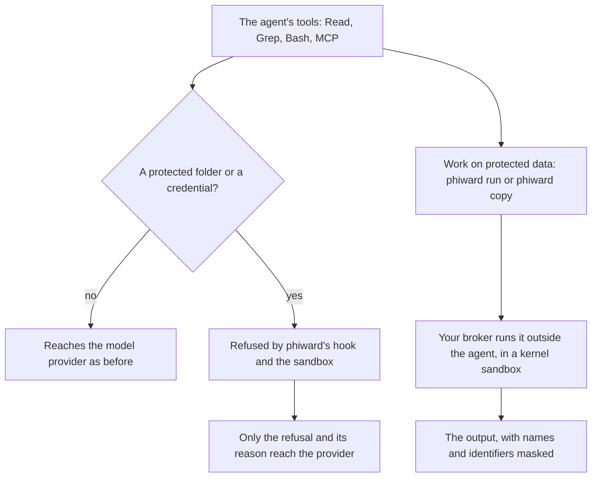

# phiward

phiward keeps protected health information (PHI) and your credentials out of what an AI coding
agent sends to its model provider. The agent's tools send their output to the provider, and that
output can hold file contents, sample identifiers or file names. With phiward, the agent works on
protected data only through a **gateway** that masks names and identifiers.

- **Status:** v0.2.0b1, a beta. See the [release notes](release-notes/v0.2.0b1.md).
- **Needs:** macOS or Linux, and Claude Code 2.1.295 or newer.
- **Install:** `uv tool install --python-preference only-managed phiward==0.2.0b1`, then the
  [quick start](quickstart.md).

## How it works

Masking hides names and identifiers, not other content. Through the gateway, print counts and
summaries, not records.

## Where to start

| You want to | Read |
|---|---|
| Set phiward up | [Quick start](quickstart.md), then [daily use](daily-use.md) |
| Work on an HPC cluster | [HPC](hpc.md) |
| Decide whether it is enough for your data | [Why phiward](why.md), [the two modes](modes.md), [the threat model](threat-model.md), [for IT and security teams](endpoint-security.md) |
| Change phiward's code | [For contributors](developer.md) |
