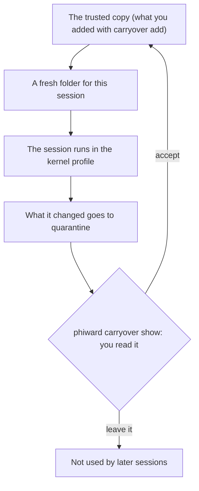

# Mode B: the agent tool under `phiward launch`

- **For:** people who run the agent in a terminal and want the whole tool confined.
- **Before:** the [quick start](quickstart.md), steps 1 and 2.
- **You will have:** sessions in phiward's kernel profile, with settings you approve.

`phiward launch --tool claude` runs **the whole agent tool**, and everything it starts,
inside the kernel profile: its file tools, shell, MCP servers and hooks. The tool cannot read your
protected data, whatever the model asks it to do. You work with protected data through the
gateway (`phiward run`, `phiward copy`), which masks what comes back. This is the
strongest mode (Mode B). A normal Claude Code session wired by the hook (Mode A) is the other;
[modes.md](modes.md) compares them.

Tested with the real Claude Code on macOS: reads of protected data by the file tools and the shell
were refused, and the gateway returned masked output. Mode B is for the terminal: driving a
`launch` session from the desktop app with Remote Control is not tested yet.

How a session's settings stay trusted:



## Once

1. Install and set up: steps 1 and 2 of the [quick start](quickstart.md).
2. A login token, because each session starts in a fresh config folder: run `claude setup-token`
   in a plain terminal, open the URL, approve, and keep the token it prints. Then, in the terminal
   where you start sessions:

   ```bash
   export CLAUDE_CODE_OAUTH_TOKEN='<the token>'
   ```

   The agent can read this variable, like an API key. Revoke it in your Claude account settings
   when you no longer need it.
3. The broker must run (for `run` and `copy`): best as a login service
   ([setup.md](setup.md#5-start-the-broker)), or `phiward broker` in a terminal of its own.

## Every session

From the project folder:

```bash
phiward launch --tool claude
```

- `--memory`: turn Claude Code's auto memory on. It then lives in the session's folder, and its
  changes go to quarantine like any other instruction.
- `launch` refuses to start in `/`, your home, a folder above or inside protected data, a dot
  folder, `~/Library`, a folder on your `PATH`, or a phiward folder.
- Several `launch` sessions may run side by side, also in one project (see limit L8 of the
  threat model).

## What a session can and cannot do

| | Can | Cannot |
|---|---|---|
| Files | read and write the project; write its own session folder and the spool | read protected roots, patterns or derived folders (`.git`, snapshots, and on Linux other mounts of the same data); read credentials (`~/.ssh`, `~/.aws`, `~/.claude`, other agent tools' logins, browser profiles, Kerberos tickets and keytabs, SSH keys your SSH config names, research-data and registry logins), shell histories, the Trash, or the gateway's `write_to` folders; write anywhere else |
| Settings that run later | | change `.mcp.json`, `.claude/settings*.json`, `.vscode` settings, or git control files (hooks, config) in the project. On Linux a git control file that is missing at the start (`commondir`) can be made; the report at the end names it. A wrapped MCP server (`--entry`) cannot write the project's `.git` folders, `.claude` or `.vscode`; on macOS also `.idea`, `.gitmodules`, `.ripgreprc` or a new `.git` (on Linux a name missing at the start can be made) |
| Processes | run any program in the profile | read other terminals, signal processes outside, inject keystrokes, open or script other apps |
| Network | open in this release (see Limits) | reach outside unix sockets (the SSH agent, your shared SSH connection, docker) |
| Protected data | `phiward run -- CMD` (masked output), `phiward copy` (no names printed) | anything else |

## When a session ends

- **The session's folder is thrown away.** Each session starts from a trusted copy in
  `~/.phiward/carryover/claude/`, which no session can read or write. Nothing is shared
  between sessions: no transcripts, no login, no caches.
- **Instruction changes go to quarantine.** These are files Claude Code reads as instructions
  or settings (`CLAUDE.md`, `rules/`, `skills/`, `agents/`, `commands/`, `plugins` you install,
  `settings.json`), and the MCP and permission keys of `.claude.json`. The exit message lists
  them:

  ```bash
  phiward carryover show --tool claude
  phiward carryover accept ID [ITEM...] --tool claude
  phiward carryover add PATH [--as NAME] --tool claude   # your own CLAUDE.md, a skill
  phiward carryover status --tool claude                 # sizes; what is safe to delete
  ```

  `accept ID settings.json` takes the whole `settings.json` as the session left it; `show` lists
  the keys that changed, and for `.claude.json` the value `accept` writes, so read it first.
  Items you do not name stay in quarantine. `add ~/.claude.json` takes only its MCP servers,
  trust and allowed-tools keys, never the login or the history; an MCP server's `env` and
  header values there are readable by the agent.
- **The project report.** It lists every file the session changed that is read as instructions
  for models (`CLAUDE.md`, `AGENTS.md`, `.claude/`), every file that runs later (git control
  files of any repository, hooks, build files, `.pth`, scripts, executables) and every settings
  file. Other changed files are named when there are 10 or fewer, and otherwise only counted;
  code under `.venv` or `node_modules` is in that count. In a very large project it says so, and
  past its limit checks only the first three kinds (dot folders such as `.claude` first); past
  2,000,000 entries it checks nothing more. **Treat everything in the project as written
  by the agent**, and read it before you run anything outside `launch`.
- **Anything under `~/.phiward` may be deleted at any time** (a disk quota, an HPC purge, or
  you). The next start rebuilds from what is left, and it never trusts a folder a session could
  write. `carryover status` says what each deletion costs.

## HPC

See [hpc.md](hpc.md): HPC through your Kerberos ticket and mounts, `copy` to approved remotes, and
`run --remote` for commands on HPC.

## Linux: the session's view

On Linux the session sees a snapshot of the file system. Every folder above a protected path or
a credential (for example `/`, `/home`, your home) is rebuilt for the session from the entries it
held at the start, without the protected ones. A protected folder replaced at its path, and a
pattern match, credential or ticket cache made after the start, are not in the view.

What this costs:
- An entry the host adds to one of those folders after the start (a new folder in your home) is
  seen only by the next session. A file the host replaces there (an editor saving `~/.gitconfig`)
  stays as it was for the session.
- A folder that is missing from the view cannot be made: `mkdir ~/.ssh` fails (read-only).
- A folder that can be entered but not listed (mode 711, common on HPC) cannot be rebuilt. It is
  shown whole, with the protected roots and credentials in it masked; one made in it later is not
  hidden.
- On Linux the view must fit in bwrap's 9000 arguments, about three for each entry it rebuilds. A
  protected folder below a folder of thousands of entries (a large data folder) would need more,
  so `launch` shows such folders whole instead, those that save the most first, and says before
  the tool starts how many folders it shows whole. In those folders, as in a 711 folder, a
  protected entry made or replaced after the start is not hidden. A folder shown whole lists its
  masked entries by name, so the folder that holds a protected root, or where a pattern's `*`
  names the protected entries, is never shown whole: if the view cannot fit then, `launch`
  refuses, and you protect that folder as a root instead (`/data/study` rather than
  `/data/study/<name>`). `launch` also counts bwrap's whole command line before it starts and
  says so when it is too long. A pattern whose `*` falls on a folder that cannot be listed cannot
  cover it: `launch` refuses, and you protect that folder as a root instead.
- A pattern follows a linked folder only in its literal part (`/data/...` through `/data ->
  /gpfs/...`), not at a `*` level: a match reached through a link there is hidden at the link
  only. Protect the target as a root.

**Protection follows the path, on Linux and macOS.** A protected folder that you move into a
folder the session can see is readable there, during a session or after it.

## Self-check

It also reports start-up files next to phiward (`.pth`, `sitecustomize` in any form) that no install
record lists, or that changed since install. One it cannot check: `_virtualenv.py`, which uv's
and virtualenv's environments add and no record lists.

`launch` checks its own installed files against the installer's record first, in a separate
Python that reads no compiled files. A changed file, a compiled file that does not match its
source, or a file the record does not list makes it refuse: reinstall. Without a record (a source
checkout or an editable install) it refuses unless `PHIWARD_DEV=1` is set. It cannot find code
that changes the launcher itself so that the check is skipped, and it trusts the installer's
record: a process running as you that changes a file **and** its record line is not found. It
is meant to catch what a session without `launch` left behind by mistake or by a careless agent;
when in doubt, reinstall: the step names the command for the tool that installed phiward.

## Limits in this release

- **Not hidden:** shell start-up files (`~/.zshrc`, which may export tokens), `~/.gitconfig`
  (which may hold an `http.extraheader`), and, on macOS, Keychain items whose access list trusts
  the `security` tool (the session can reach the Keychain service). Keep tokens out of start-up
  files; prefer Mode A's test result for Keychain-backed tokens until Mode B is checked.
- **Git control files are read-only** for the repositories found at the start, so `git remote
  add`, `git config`, `git submodule update --init`, `git worktree add` and `git push -u` fail
  inside `launch` (and `git switch` to a remote branch, `git branch -u`, `-m` and `-d` cannot
  record their settings: `git switch` still prints "set up to track" but does not); run them in
  your own terminal. A repository the session makes is not
  read-only, but its control files are listed in the exit report as files that run later.

Read [threat-model.md](threat-model.md) (Mode B, limits L1–L8). In short:
- **The network is open.** A session cannot read protected data, so it cannot send it. But it
  can carry out what it can read: gateway output (masked), the login token, the project.
- **macOS:** a process that leaves the tool's process tree keeps running after the session
  (L5). It can no longer change what a later session reads, but it can write the project. Close
  the terminal after a session.
- **macOS:** the Keychain and the per-user temp folder are shared with your own tools.
- **Masking covers names and identifiers, not content.** Through the gateway, print counts and
  summaries, not records (rule 3 of the agent rules that `phiward init` adds to `AGENTS.md`). Dates can be masked with the `dates` pack.
- `tmux`, `script` and other tools that open a new terminal do not work yet.
- Other tools than Claude Code run under `launch -- PROGRAM` with the boundary, but without a
  per-session config folder (no adapter yet).

Next: what Mode B does not cover is in [the threat model](threat-model.md#mode-b-phiward-launch).
