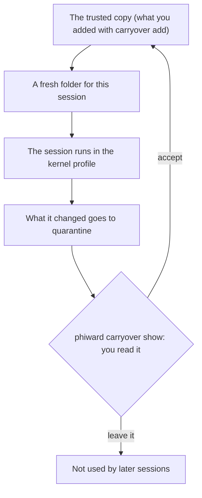

# Mode B: the agent tool under `phiward launch`

- **For:** people who run the agent in a terminal and want the whole tool confined.
- **Before:** the [quick start](quickstart.md), steps 1 and 2.
- **You will have:** sessions in phiward's kernel profile, with settings you approve.

`phiward launch --tool claude` runs **the whole agent tool**, and everything it starts,
inside the kernel profile: its file tools, shell, MCP servers and hooks. The tool cannot read your
protected data, whatever the model asks it to do. You work with protected data through the
gateway (`phiward run`, `phiward copy`), which masks what comes back. This is the
strongest mode (Mode B). A normal Claude Code session wired by the hook (Mode A) is the other;
[modes.md](modes.md) compares them.

Tested with the real Claude Code on macOS: reads of protected data by the file tools and the shell
were refused, and the gateway returned masked output. Mode B is for the terminal: driving a
`launch` session from the desktop app with Remote Control is not tested yet.

How a session's settings stay trusted:



## Once

1. Install and set up: steps 1 and 2 of the [quick start](quickstart.md).
2. A login token, because each session starts in a fresh config folder: run `claude setup-token`
   in a plain terminal, open the URL, approve, and keep the token it prints. Then, in the terminal
   where you start sessions:

   ```bash
   export CLAUDE_CODE_OAUTH_TOKEN='<the token>'
   ```

   The agent can read this variable, like an API key. Revoke it in your Claude account settings
   when you no longer need it.
3. The broker must run (for `run` and `copy`): best as a login service
   ([setup.md](setup.md#5-start-the-broker)), or `phiward broker` in a terminal of its own.

On a Mac with an endpoint tool: a session starts `/usr/bin/sandbox-exec -f <profile>` with the
tool's full path, and Claude Code then starts phiward's hook on each tool call.
[endpoint-security.md](endpoint-security.md) lists each command line, for your IT or security
team.

## Every session

From the project folder:

```bash
phiward launch --tool claude
```

- `--memory`: turn Claude Code's auto memory on. It then lives in the session's folder, and its
  changes go to quarantine like any other instruction.
- `launch` refuses to start in `/`, your home, a folder above or inside protected data, a dot
  folder, `~/Library`, a folder on your `PATH`, or a phiward folder. On Linux it also refuses
  `/tmp` itself (as the project or the spool): the session's own `/tmp` would be the shared one.
  A folder below `/tmp` works.
- **Python environments:** an activated `.venv` puts a folder of the project on your `PATH`, so
  `launch` refuses: your own shell would run what the session wrote there. The refusal names the
  entry: `PATH holds /path/to/project/.venv/bin, inside the project; ... Run deactivate (or take
  it off PATH), then start again`. Run `deactivate` before `launch`; inside the session, use
  `.venv/bin/python` or `uv run`. For another entry (direnv), take it off `PATH` (`direnv deny`).
- `--resume` and `-c` find this project's earlier `launch` sessions
  ([When a session ends](#when-a-session-ends)).
- `launch` refuses to start when the masking check fails: `the masking check failed: ...; run
  phiward doctor`. A value of `[sanitize] examples` is not fully masked by your own rules, or a
  made-up path below a root came out unmasked
  ([configuration.md](configuration.md#sanitize)). Fix the rule, the example or the root, then
  start again. A wrapped MCP server (`launch --server`) is not checked.
- `launch` refuses to start when the project scan finds a subject or sample ID in a project
  file or a file name ([The project scan](#the-project-scan)).
- Several `launch` sessions may run side by side, also in one project (see limit L8 of the
  threat model).
- On macOS the tool starts as `/usr/bin/sandbox-exec -f FILE TOOL ARGS...`, with nothing in
  between. The profile is a new file in `~/.phiward/profiles`, as for the gateway, removed when
  the tool ends. A program name is found on the session's `PATH` first; when there is none,
  `launch` says so and exits 127. Inside another sandbox, `sandbox-exec` cannot apply the
  profile, and nothing runs. When the tool exits with an error within a few seconds of its
  start, `launch` adds a line: if `sandbox-exec` printed an error above it, `phiward doctor`
  names the cause (inside another sandbox, or a profile that does not compile).
- The hooks `launch` writes into the session's settings (the fast hook and the prompt check)
  run from a file in phiward's package, `<python> -I -S <package>/phiward/entry.py ...`, with
  `onFailure: "block"`. So `launch --tool claude` refuses, on macOS and Linux, a Claude Code
  older than 2.1.295, which would not honour them. It never starts a program inside the
  project or the session's folders to learn the version. It asks the native binary
  `TOOL --version`, from `/`. It never starts a script (the npm build): the script's
  interpreter, or a shim's config, could be the session's. It reads the version from the
  `package.json` of the script's npm package (`@anthropic-ai/claude-code`). A tool that gives
  no Claude Code version (another program, a wrapper, a mise or asdf shim) is refused too:
  run Claude Code's own program directly (the native binary, or the npm package's `cli.js`),
  or use `--tool generic` for another tool. `phiward doctor` warns about a wrapper before the
  start ([refusals.md](refusals.md)).

## The project scan

A file in the project is outside the protected roots, so the agent reads it with no gateway.
Claude Code also sends `CLAUDE.md` and the list of file names at the start, with no tool call.
So, before the tool starts, `launch` reads the project for subject and sample IDs.

- **The rules:** the subject rules only: your `[sanitize] patterns`, your pack files, and the
  built-in packs in force (a repo's `.phiward.toml` may add one, such as `msk`). Not file
  names, read names, positions, numbers, dates, protected paths or the entry names under the
  roots: a project holds those everywhere. With no subject rule, there is no scan.
- **What it reads:** one walk of the project folder, git-ignored files too: first the
  instruction files Claude Code sends at the start (`CLAUDE.md`, `CLAUDE.local.md`,
  `AGENTS.md`, `.claude/`), names and content; then every other name, breadth first; then the
  other files' content, the smallest first. Of each
  regular file it reads the first 64 KiB (`phiward doctor`: 1 MiB): of its decompressed form
  for gzip and BGZF (`.csv.gz`, `.vcf.gz`), and as UTF-16 with a BOM (Excel's "Unicode text").
  A folder named after an ID is one finding, not one for each file below it.
- **What it does not read:** binary files (a NUL byte in the first 8 KiB: xlsx, parquet, BAM),
  lines over 64 KiB, anything past the first 64 KiB (doctor: 1 MiB), the targets of links, files it cannot open,
  more than 10000 entries of one folder, the protected and hidden paths, the folders of
  installed code and caches (`node_modules`, `.venv`, `venv`, `site-packages`, `renv/library`,
  `.tox`, `target`, `.git`, `__pycache__`, `.mypy_cache`, `.pytest_cache`, `.ruff_cache`,
  `.claude/worktrees`), and the paths in `[sanitize] scan_allow`. It runs no git command:
  git would run programs that the project's `.git/config` names.
- **On a finding:** `launch` refuses, and says the kinds and counts only:
  `the project scan found <SUBJECT> in 3 files: move the data under a protected root,
  pseudonymize it (phiward pseudonymize), or allow the files ([sanitize] scan_allow); phiward
  doctor --show-paths lists them`. Run `phiward doctor --show-paths` in your own terminal to see
  the files (masked paths and line numbers). Then move the data under a protected root, make a
  pseudonymized copy (`phiward pseudonymize`), or, for made-up IDs only, add the files to
  `[sanitize] scan_allow` in your user config
  ([configuration.md](configuration.md#sanitize)).
- **The budget:** 2 s. On a made-up project of 5,012 files (5,000 source files of 4 KB and ten
  2 MiB tables), the scan read all of them in 1.6 s on the maintainer's Mac. A larger project starts
  anyway, after one line: `phiward launch: NOTE: the project scan stopped at its 2 s limit
  after N files; run phiward doctor for the full scan`. An ID found before the limit still
  refuses. `phiward doctor` scans with no limit. A scan that finished but left part of the
  project unread (files past their head, long lines, folders over the entry cap, files it
  cannot open) starts with one NOTE of those counts.
- **A scan that cannot run** refuses: `the project scan could not run; run phiward doctor`.
- **`[launch] write_to` folders** are scanned too, in the same 2 s, the instruction files of
  every folder first ([More folders to write](#more-folders-to-write)).
- A wrapped MCP server (`--entry`) is not scanned: its folder is not the agent's project.
- **Mode A** has no launch: the SessionStart note runs the same scan within 2 s and, on a
  finding, tells the session the kinds and counts (it never stops the session), and
  `phiward doctor` warns. Under `launch` the note does not scan again. `phiward doctor --headless` lists a finding as a reason.

## What a session can and cannot do

| | Can | Cannot |
|---|---|---|
| Files | read and write the project and the [`[launch] write_to`](#more-folders-to-write) folders (user config); write its own session folder and the spool | read protected roots, patterns or derived folders (`.git`, snapshots, and on Linux other mounts of the same data); read credentials (`~/.ssh`, `~/.aws`, `~/.claude`, other agent tools' logins, browser profiles, Kerberos tickets and keytabs, SSH keys your SSH config names, research-data and registry logins), shell histories, the Trash, or the gateway's `write_to` folders; write anywhere else |
| Files that run later | | write, at any depth in the project and in each `[launch] write_to` folder, the `.claude`, `.vscode`, `.idea`, `.cursor`, `.gemini` and `.codex` folders (each as a whole), `.mcp.json`, `.gitmodules`, `.ripgreprc`, `.Rprofile` or `.Renviron`, or what a link inside them leads to; or git control files (hooks, config). On Linux `launch` makes `.claude`, `.vscode` and `.idea` in the project if there are none and `.mcp.json` as a `{}` placeholder; the others, a git control file missing at the start (`commondir`), and one of these made in a subfolder during the session can be made there, and the report at the end names them. In a `[launch] write_to` folder launch makes nothing; one missing at the start can be made there, and the report at the end names it. A wrapped MCP server (`--entry`) has the same profile, and cannot write the project's `.git` folders at all (on macOS also a new `.git`) |
| Processes | run any program in the profile | read other terminals, signal processes outside, inject keystrokes, open or script other apps; on macOS also mount file systems or create launchd jobs |
| Network | tunnels (CONNECT) to public addresses, through phiward's proxy ([below](#the-network)) | reach this machine's own services, its link or private ranges; use plain HTTP, UDP, or tools that ignore the proxy variables; reach outside unix sockets (the SSH agent, your shared SSH connection, docker); on Linux before 7.1, see Limits for what stays outside Claude Code's sandbox |
| Protected data | `phiward run -- CMD` (masked output), `phiward copy` (no names printed) | anything else |

## More folders to write

A project may need to write a sibling repository, a shared output folder or a scratch area.
List those folders in your user config (a repo's `.phiward.toml` cannot):

```toml
[launch]
write_to = ["~/work/shared-results", "/data/me/scratch"]
```

- **The checks, at each start.** launch refuses to start, naming the entry and the step ("fix
  or remove it in [launch] write_to of the user config"), for an entry that is:
  - a file, a link, or reached through a link (whoever can change the link would choose the
    place); name the real folder;
  - inside or above a protected root, a derived folder or a pattern match;
  - `/`, the home folder or above it, a dot-folder of the home folder (`~/.config`,
    `~/.claude`, `~/.phiward`), in `~/Library`, or a folder that is, holds or is inside a
    `PATH` folder (files there run later, outside launch);
  - a folder that holds a phiward file (the config, its code) or is the spool;
  - a `[broker] write_to` folder, or one that holds or is inside one, or a credential.

  The hook does not check them, so a bad entry stops only launch. `phiward doctor` gives the
  same refusals.
- **A missing entry is skipped,** with one NOTE: `phiward launch: NOTE: [launch] write_to
  <entry> does not exist, so the session does not write there`. An entry inside the project
  is dropped (the project is written already); one inside another entry is dropped too.
- **The folders are named at the start:** `phiward launch: the session also writes: <folder>,
  ...`, and in the `--report` JSON (`write_to`). `phiward doctor` counts them (the paths with
  `--show-paths`).
- **The project's rules hold in each folder.** What runs later and git control files are
  read-only there, as in the project (the table above). launch makes nothing in a listed
  folder: on Linux, one of them missing at the start can be made, and the report at the end
  names it. A repository made in a listed folder during the session has writable git control
  files on both platforms, as in the project; the report at the end names its `.git/` paths.
- **The project scan reads each folder** with the project's rules and within the same 2 s:
  first the instruction files of the project and of every listed folder, then the rest of each
  in turn. A finding in any folder refuses, naming the folder. A listed folder's instruction
  files not read in 2 s refuse ("run phiward doctor, or make them smaller"); the project's own,
  and the rest not read, give the NOTE, naming the folders not finished.
- **`--tool claude` gets `--add-dir D`** for each folder, after your own arguments (so a `--`
  among them is refused). From an `--add-dir` folder Claude Code loads its skills (live), its
  commands and its subagents, `enabledPlugins` and `extraKnownMarketplaces` of its settings,
  and with `CLAUDE_CODE_ADDITIONAL_DIRECTORIES_CLAUDE_MD=1` (passed on as you set it) its
  `CLAUDE.md` and rules. All of them sit under `.claude`, which is read-only there and scanned
  before the tool starts.
- **The trust prompt.** Claude Code 2.1.326 and newer asks you to trust each `--add-dir`
  folder. Under launch every session starts with a fresh config folder, so it asks again in
  every session. That is expected: answer it, or remove the entry.
- **The end report** names what the session changed in each folder, under the folder's name.
  Each folder is walked at the start and at the end, up to 2 million entries: list a folder,
  not a whole disk.
- **An abnormal end.** SIGHUP (the terminal closes) and SIGTERM still give the end report (one
  ignored when launch starts, as under `nohup`, stays ignored). After a signal, a SIGKILL or a
  crash, the next launch names the folders of the session that did not finish (on macOS the
  tool may outlive the launcher): read their files that run later and what it changed before
  you run anything there.
- **Not `[broker] write_to`.** That one is the gateway's grant to write inside protected roots,
  which a session cannot read; this one is what the session itself writes. The two may never
  overlap ([configuration.md](configuration.md#launch)).
- The broker's `PATH` filter and `phiward pseudonymize` treat the listed folders as written by
  the agent: a program there is not run by the broker, and a table there is not an input.

## The network

The session has no direct outbound network. `launch` runs a proxy outside the profile, and the tool's
`HTTPS_PROXY`, `HTTP_PROXY` and `ALL_PROXY` (and their lowercase forms) name it, with a token for
this session only; `NO_PROXY` is empty. Claude Code, git, pip, npm and curl use it.

- **Only public addresses.** The proxy looks the name up once, checks every address it gets
  back, and connects to the checked addresses in turn (so broken IPv6 falls back to IPv4). It refuses this machine (`localhost`,
  `127.0.0.1` in any spelling, `[::1]`, this machine's names and addresses, which it reads again
  for each connection), the local link (`169.254.x`, `fe80::`) and the private ranges (`10.x`,
  `172.16-31.x`, `192.168.x`, `100.64.x`, `fc00::/7`).
- **Private ranges you need** (an HPC web service, an internal Git server): list them in
  `[launch] private_networks` in your user config ([configuration.md](configuration.md#launch)).
  A project's `.phiward.toml` cannot.
- **Tunnels only** (CONNECT), to any port of a checked address: HTTPS, and whatever else a tool
  sends through a CONNECT tunnel. Plain HTTP requests through the proxy are refused.
- **A proxy of your own:** when the terminal you start `launch` from sets `HTTPS_PROXY` (or
  `ALL_PROXY`) to an `http://` proxy, phiward's proxy goes through it, by the checked address
  only (`CONNECT <address>:443`). A name that does not resolve on this machine is refused, not
  sent on. An address in your `[launch] private_networks` is connected to directly, not through
  that proxy (it does not reach your internal network). Any other kind of proxy there
  (`https://`, `socks5://`) stops the start.
- **At most 64 connections at once.** One more is refused, not queued.
- **A refusal says why.** The proxy answers `403 phiward: <why>` in the status line and the
  body; most tools print only the status line (`pip`: "Tunnel connection failed: 403 phiward:
  ..."). For a private address it reads `git.example.internal is a private address; the operator
  lists its range in [launch] private_networks (user config)`. At exit, `launch` prints the hosts
  it refused (the first 20), also into `--report`: `phiward launch: the proxy refused 2
  connection(s): git.example.internal (a private address), ...; private ranges go in [launch]
  private_networks (user config)`.
- **`ANTHROPIC_BASE_URL`** (`--tool claude`): checked at the start with the proxy's rules. A
  URL that is not `https://`, or whose host is this machine, its link, or a private range you
  have not listed, stops the start, since the session could not reach its model: for example
  `ANTHROPIC_BASE_URL (http://127.0.0.1:4000) is not an https:// URL; ...: run Claude Code in
  Mode A`. A name that does not resolve at the start is left to the proxy.
- `launch` refuses to start when the proxy cannot start.

What this breaks:
- MCP servers over HTTP on this machine, IDE integrations (the IDE's WebSocket on localhost),
  and `/login` with a localhost callback (use `CLAUDE_CODE_OAUTH_TOKEN`, above). Stdio MCP
  servers the session starts work.
- Tools that ignore the proxy variables (raw sockets, `ssh` to port 22, some Go and Java tools),
  and all UDP. They fail visibly.
- Docker over TCP (`DOCKER_HOST=tcp://localhost`); the Docker socket is blocked already.
- **macOS:** the session cannot reach a server on this machine, also one it started itself: test
  suites with local HTTP fixtures, dev servers, Jupyter kernels (ZMQ over TCP by default) and Dask
  local clusters. Use unix sockets in the project or the session's temp folder, or an IPC
  transport (`jupyter ... --transport ipc`). Name lookups still work. A server the session
  starts can listen on every address, and the LAN can reach it: bind local servers to
  `127.0.0.1` (`python -m http.server --bind 127.0.0.1`) ([the limit](threat-model.md#open-network)).
- **Linux:** the session has a network of its own, with its own `localhost`: servers it starts
  itself work. The proxy variables name a relay on that `localhost`, which gets each connection
  to the proxy as a socket pair from `launch` (no socket file; it works also where the tool
  cannot make unix sockets). Name lookups inside the session fail (`ping`, `dig`, `ssh` to a name); tools that
  use the proxy do not need them. `launch` refuses to start where network namespaces are not
  available: it says so when `user.max_net_namespaces` is 0, and bubblewrap stops the start
  when it cannot make one for another reason. Nothing runs then; `phiward doctor` checks both.

## When a session ends

- **The session's folder is thrown away.** Each session starts from a trusted copy in
  `~/.phiward/carryover/claude/`, which no session can read or write. Only this project's
  transcripts are shared between sessions: no login, no caches, no other project's history.
- **This project's transcripts are kept**, so `claude --resume` and `claude -c` work under
  `launch`. `launch` names the session's transcript folder (`CLAUDE_CODE_PROJECT_DIR_NAME`, the
  first 16 hex digits of the sha256 of the project's real path). At the end it copies that folder
  whole into `~/.phiward/carryover/claude/transcripts/<16 hex>/`, and at the next start back
  into the new session's folder. phiward never reads a transcript: their format is Claude Code's
  own.
  - Only plain files and real folders are kept. Links are dropped with a NOTE. `memory/` (auto
    memory, an instruction) and `mcp-tasks/` are never kept, in any letter case.
  - Sessions that end one after the other are merged; a file is replaced only by a newer one.
  - At most 500 MB and 20,000 entries for each project; past that, the oldest sessions go first.
    A session larger than that on its own is not kept, and its end says so with a NOTE.
  - A resumed session restores what Claude Code restores (the conversation, the model, the
    agent, a permission mode other than bypass, an active goal, scheduled tasks), inside the
    kernel profile and `launch`'s hooks. What an earlier session wrote is read as history
    ([the limit](threat-model.md#open-transcripts)).
  - **To delete them:** delete `~/.phiward/carryover/claude/transcripts/` (all projects) or one
    `<16 hex>/` folder in it, when no session runs. `phiward carryover status --tool claude`
    lists each project's folder and its size. Claude Code's own commands do not reach them
    (under `launch` they see only the session's folder).
  - **To turn it off:** `[launch] keep_transcripts = false` in your user config
    ([configuration.md](configuration.md#launch)). Each session then starts with no history,
    and `--resume` or `-c` gets a NOTE.
- **Instruction changes go to quarantine.** These are files Claude Code reads as instructions
  or settings (`CLAUDE.md`, `rules/`, `skills/`, `agents/`, `commands/`, `plugins` you install,
  `settings.json`), and the MCP and permission keys of `.claude.json`. The exit message lists
  them:

  ```bash
  phiward carryover show --tool claude
  phiward carryover accept ID [ITEM...] --tool claude
  phiward carryover add PATH [--as NAME] --tool claude   # your own CLAUDE.md, a skill
  phiward carryover status --tool claude                 # sizes; what is safe to delete (kept transcripts too)
  ```

  `accept ID settings.json` takes the whole `settings.json` as the session left it; `show` lists
  the keys that changed, and for `.claude.json` the value `accept` writes, so read it first.
  Items you do not name stay in quarantine. `add ~/.claude.json` takes only its MCP servers,
  trust and allowed-tools keys, never the login or the history; an MCP server's `env` and
  header values there are readable by the agent.
- **The project report.** It lists every file the session changed that is read as instructions
  for models (`CLAUDE.md`, `AGENTS.md`, `.claude/`), every file that runs later (git control
  files of any repository, hooks, build files, `.pth`, scripts, executables) and every settings
  file. Other changed files are named when there are 10 or fewer, and otherwise only counted;
  code under `.venv` or `node_modules` is in that count. In a very large project it says so, and
  past its limit checks only the first three kinds (dot folders such as `.claude` first); past
  2,000,000 entries it checks nothing more. **Treat everything in the project as written
  by the agent**, and read it before you run anything outside `launch`. Each `[launch]
  write_to` folder gets a report of its own, under its name.
- **Anything under `~/.phiward` may be deleted at any time** (a disk quota, an HPC purge, or
  you). The next start rebuilds from what is left, and it never trusts a folder a session could
  write. `carryover status` says what each deletion costs.

## HPC

See [hpc.md](hpc.md): HPC through your Kerberos ticket and mounts, `copy` to approved remotes, and
`run --remote` for commands on HPC.

## Linux: the session's view

On Linux the session sees a snapshot of the file system. Every folder above a protected path or
a credential (for example `/`, `/home`, your home) is rebuilt for the session from the entries it
held at the start, without the protected ones. A protected folder replaced at its path, and a
pattern match, credential or ticket cache made after the start, are not in the view.

What this costs:
- An entry the host adds to one of those folders after the start (a new folder in your home) is
  seen only by the next session. A file the host replaces there (an editor saving `~/.gitconfig`)
  stays as it was for the session.
- The session's view is checked against what was checked before the tool starts. An entry the
  host removes from one of those folders while the session starts is left out of the view. An
  entry the host replaces while the session starts stops the start: nothing runs; start again.
  A short window stays: an entry removed between bubblewrap's own check and its mount stops the
  start with `bwrap: Can't bind mount ...`; start again.
- A folder that is missing from the view cannot be made: `mkdir ~/.ssh` fails (read-only).
- A folder that can be entered but not listed (mode 711, common on HPC) cannot be rebuilt. It is
  shown whole, with the protected roots and credentials in it masked; one made in it later is not
  hidden.
- On Linux the view must fit in bwrap's 9000 arguments, about three for each entry it rebuilds. A
  protected folder below a folder of thousands of entries (a large data folder) would need more,
  so `launch` shows such folders whole instead, those that save the most first, and says before
  the tool starts how many folders it shows whole. In those folders, as in a 711 folder, a
  protected entry made or replaced after the start is not hidden. A folder shown whole lists its
  masked entries by name, so the folder that holds a protected root, or where a pattern's `*`
  names the protected entries, is never shown whole: if the view cannot fit then, `launch`
  refuses, and you protect that folder as a root instead (`/data/study` rather than
  `/data/study/<name>`). `launch` also counts bwrap's whole command line before it starts and
  says so when it is too long. A pattern whose `*` falls on a folder that cannot be listed cannot
  cover it: `launch` refuses, and you protect that folder as a root instead.
- A pattern follows a linked folder only in its literal part (`/data/...` through `/data ->
  /gpfs/...`), not at a `*` level: a match reached through a link there is hidden at the link
  only. Protect the target as a root.

**Protection follows the path, on Linux and macOS.** A protected folder that you move into a
folder the session can see is readable there, during a session or after it.

## Self-check

It also reports start-up files next to phiward (`.pth`, `sitecustomize` in any form) that no install
record lists, or that changed since install. One it cannot check: `_virtualenv.py`, which uv's
and virtualenv's environments add and no record lists.

`launch` checks its own installed files against the installer's record first, in a separate
Python that reads no compiled files. A changed file, a compiled file that does not match its
source, or a file the record does not list makes it refuse: reinstall. Without a record (a source
checkout or an editable install) it refuses unless `PHIWARD_DEV=1` is set. It cannot find code
that changes the launcher itself so that the check is skipped, and it trusts the installer's
record: a process running as you that changes a file **and** its record line is not found. It
is meant to catch what a session without `launch` left behind by mistake or by a careless agent;
when in doubt, reinstall: the step names the command for the tool that installed phiward.

## Limits in this release

- **Not hidden:** shell start-up files (`~/.zshrc`, which may export tokens), `~/.gitconfig`
  (which may hold an `http.extraheader`), and, on macOS, Keychain items whose access list trusts
  the `security` tool (the session can reach the Keychain service). Keep tokens out of start-up
  files; prefer Mode A's test result for Keychain-backed tokens until Mode B is checked.
- **Files that other tools run later are read-only.** Skills, agents, commands, hooks and
  settings in the project's `.claude`, and editor and agent-tool settings (`.vscode`, `.idea`,
  `.cursor`, `.gemini`, `.codex`), cannot be written inside `launch`: edit them in your own
  terminal, or bring them in with `phiward carryover add`. Claude Code's `--worktree` and agent worktrees
  (`isolation: worktree`; both write `.claude/worktrees/`) and `/loop` durable tasks (`.claude/scheduled_tasks.json`) do not work
  inside `launch`. A folder that a link in them leads to (`.claude/skills -> ../.agents/skills`)
  is read-only too; `launch` refuses to start when such a link leads to a folder that holds the
  project, to one that does not exist (Linux), or when one of these folders has more entries than
  it walks for links (50,000 in one tree; it names the folder). Trees of installed code
  (`node_modules`, `.venv`, `venv`, `site-packages`, `renv/library`, `.tox`, `target`, `.git`, `__pycache__`, `.mypy_cache`; `SKIP_TREES` in `wholetool.py`) are not
  walked, and a `.vscode` or `.idea` inside them stays writable, so `npm install` works; nor are
  the links in `.claude/worktrees` followed. R: `.Rprofile` and `.Renviron` are read-only, so run `renv::init()` (it writes
  `.Rprofile`) once outside `launch`; `renv::restore()` and plain R work inside it (they write
  `renv/library`, which stays writable).
- **A `git pull`, `checkout` or `switch` that changes a tracked file in a `.claude`, `.vscode` or
  `.idea` folder** (at any depth) fails partway inside `launch`, since those folders are
  read-only. Run them in your own terminal.
- **Git control files are read-only** for the repositories found at the start, so `git remote
  add`, `git config`, `git submodule update --init`, `git worktree add` and `git push -u` fail
  inside `launch` (and `git switch` to a remote branch, `git branch -u`, `-m` and `-d` cannot
  record their settings: `git switch` still prints "set up to track" but does not); run them in
  your own terminal. A repository the session makes is not
  read-only, but its control files are listed in the exit report as files that run later.
- **Linux: Claude Code's own sandbox runs inside launch.** phiward turns it off only on macOS.
  On Linux its bubblewrap starts inside phiward's, and where the host refuses a user namespace
  inside bubblewrap, Claude Code's Bash tool fails (visibly: the command is refused, nothing
  runs unconfined). The session's settings set `sandbox.allowUnsandboxedCommands: false`, so a
  Bash command is not retried outside it. Bash reaches the network through Claude Code's own
  proxy, which then goes through phiward's; that a given Claude Code version does this is for
  the real-tool check to confirm.
- **Linux: unix sockets.** `launch` does not mask sockets by name; the kernel limits them.
  - From Linux 7.1 (Landlock ABI 9): the session reaches only the unix sockets it made itself,
    and the system's name-service sockets (sssd, nscd).
  - Before 7.1, with `--tool claude`: Claude Code's own sandbox blocks unix sockets for Bash
    (its seccomp filter, which the native build carries). `launch` turns that sandbox on with
    `--settings` (`sandbox.enabled`, `sandbox.failIfUnavailable`,
    `sandbox.allowUnsandboxedCommands` false, and `env.CLAUDE_CODE_DISABLE_FILE_MENTIONS`:
    the file `install` writes for `claude --settings`), passed as the last arguments of whatever
    `--tool claude` runs (`claude`, a versioned binary, a wrapper); a `--` among the arguments
    stops the start (drop the `--` and put the prompt last). Claude Code keeps only one `--settings`, so your own stops the start too,
    unless its content is just the same (the file `install` writes, as a shell alias adds it;
    launch reads the content, not the path). One more key, another value or a file that does
    not parse stops the start.
    Under `launch`, Claude Code reads a config folder of its own, not `~/.claude`: put other
    settings in managed settings, or add a `settings.json` with `phiward carryover add FILE
    --as settings.json --tool claude`. A Claude Code command (`claude mcp`, `doctor`, `logs`,
    ...), also after options (`claude --debug mcp list`), is not a session: some ignore
    `--settings` and run, and some are hidden from the help. `launch` refuses it: run it outside
    `launch`. To tell a command from a prompt, `launch` asks the program that runs, inside
    the session: `claude WORD --help` for the first word that is not an option (which options
    take a value comes from `claude --help`). A help other than the root's means a command; so
    `claude -p mcp` is refused too. A help that hangs, fails or is empty stops the start.
    Some options run something other than a session (`--chrome-native-host`, `--preload`,
    `--eval-mock-server`, `--daemon-worker`). `launch` does not refuse them; they run inside
    the session's confinement, so the guards still hold. Cost: one help run
    at each start, and one more when there is such a word. Only Claude Code's native build is accepted (npm
    and the installer give it from 2.1.250; for an older JavaScript build, run `claude
    install`). Before the tool starts, `launch` runs the filter of the program that will run
    (found on the session's `PATH`, then run by its real path) as Claude Code does (the native
    binary with `ARGV0=apply-seccomp`) and requires `socket(AF_UNIX)` to fail. So run the
    Claude Code binary itself: `env`, `npx`, `node`, a JavaScript program or a wrapper that
    adds arguments does not pass.
    It refuses to start when the filter does not block unix sockets, when the session can
    write the program's real file or a folder above it, on a machine other than x86_64 or
    aarch64, or when settings
    open the sandbox (`excludedCommands`, `allowAllUnixSockets`, `allowUnixSockets`,
    `enableWeakerNestedSandbox`). A read-only wrapper of your own, inside the project, that
    runs a native binary the session can write is not caught: only the wrapper is checked.
    The tests use a made-up native build. Only the sandbox check shows that the real
    binary's filter works inside launch's bubblewrap, and whether sessions that Claude Code
    starts in the background (`--bg`, its background service) get the same sandbox
    settings. Claude Code
    also needs `socat` and bubblewrap. Bash then cannot use any unix socket, so `tmux` and
    Python's `forkserver` fail there. Hooks, MCP servers, the status line and Claude Code
    itself run outside that sandbox: they can reach sockets outside. You configure them; the
    session cannot, because the project's `.claude` is read-only.
  - Before 7.1, with any other tool (`--tool generic`, a wrapped MCP server): the tool cannot
    make unix sockets at all, also its own (socketpairs and pipes work).
- **A launch inside a session** (a wrapped MCP server, or a launch for another project) runs its
  command directly, under the session's own profile: not the narrower profile of a server (which
  keeps more of the project read-only), and not another project's `.phiward.toml`. On macOS it decides from the session's own folder, found
  from your account's home folder (not `HOME`): a file there that only that profile denies, and
  a new file that only the session can make in its own run folder (`PHIWARD_RUN`, which `launch`
  sets);
  on Linux the session's seccomp filter answers one unused system call with an error number
  nothing else gives. Anything else (no filter, another sandbox's filter) builds the full
  profile; where `~/.phiward` cannot be written, that launch refuses and nothing runs.

Read [threat-model.md](threat-model.md) (Mode B, [limits L1–L10](threat-model.md#l1)). In short:
- **The network goes only to public addresses, through phiward's proxy** ([above](#the-network)).
  A session cannot read protected data, so it cannot send it. But it can carry out what it can
  read, to any public host: gateway output (masked), the login token, the project.
- **macOS:** a process that leaves the tool's process tree keeps running after the session
  (L5). It can no longer change what a later session reads, but it can write the project, and
  it keeps its session's one allowed port after the proxy is gone. Close the terminal after a
  session.
- **macOS:** the Keychain and the per-user temp folder are shared with your own tools.
- **Masking covers names and identifiers, not content.** Through the gateway, print counts and
  summaries, not records, and hide small counts ([Small counts](daily-use.md#small-counts)) (rule 3 of the agent rules that `phiward init` adds to `AGENTS.md`). Dates can be masked with the `dates` pack.
- `tmux`, `script` and other tools that open a new terminal do not work yet.
- Other tools than Claude Code run under `launch -- PROGRAM` with the boundary, but without a
  per-session config folder (no adapter yet).

Next: what Mode B does not cover is in [the threat model](threat-model.md#mode-b-phiward-launch).
