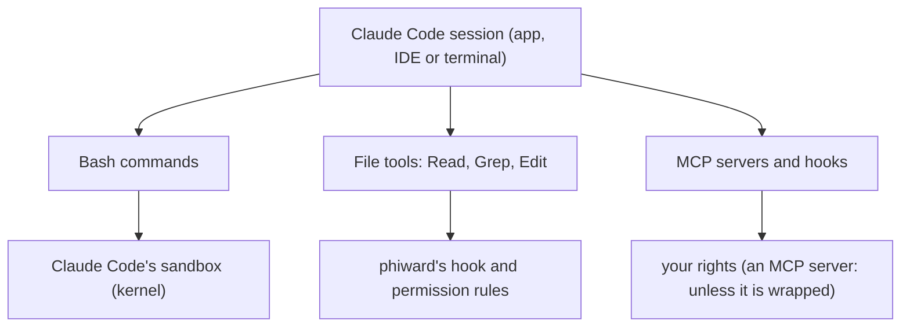
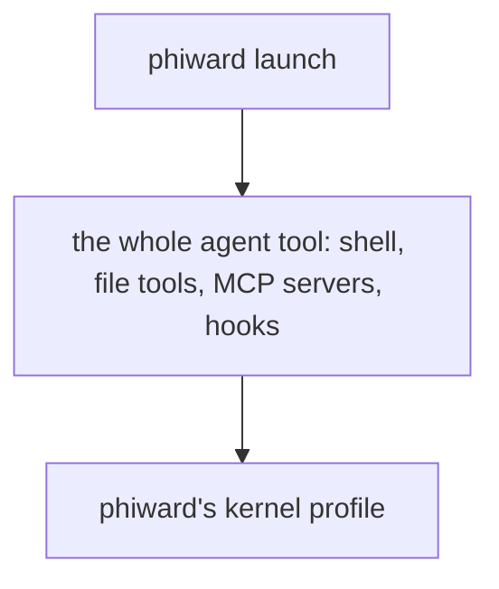

# Choose a mode: a Claude Code session (Mode A) or `phiward launch` (Mode B)

**For:** anyone who chooses between the two modes, or decides whether phiward is enough.

phiward protects protected data in two ways. Both use the same user config, the same broker and
the same gateway (`phiward run`, `phiward copy`, `phiward run --remote`), so work on protected
data is equally protected in both. What differs is how much of the agent tool itself is
confined. Words are explained in the [glossary](glossary.md).

What confines what, in Mode A:



And in Mode B:



In both, work on protected data goes through the gateway.

**The hidden list** (both modes): credentials (`~/.ssh`, `~/.aws`, `~/.config/gh`, other agent
tools' and the Claude app's logins, browser profiles), Kerberos ticket caches and keytabs, SSH
keys your ssh configs name, shell and REPL histories, the Trash, thumbnails, local IPC sockets.
In Mode A, `install` puts it in Claude Code's sandbox and permission rules, and the hook refuses
it; in Mode B the kernel hides it. Gateway commands cannot read it either. In Mode A,
Claude Code's own folder (`~/.claude`: memory, plans, skills, saved tool output) stays usable;
only its login files (`.credentials.json`, `~/.claude.json`) are hidden.

| | **Mode A: a Claude Code session** | **Mode B: `phiward launch`** |
|---|---|---|
| Start | open the project as usual: the desktop app, an IDE, or `claude` in a terminal | `phiward launch --tool claude` in a terminal (terminal only for now: driving it from the app with Remote Control is not tested) |
| Set up | `phiward setup` (it wires your user settings), once; `phiward init` in each project with protected work | [launch.md](launch.md), once |
| Bash commands | in Claude Code's own sandbox (the kernel): protected paths and the hidden list cannot be read | in phiward's kernel profile |
| File tools (Read, Grep, Glob, Edit) | refused by phiward's hook and by Claude Code's permission rules (inside Claude Code, not the kernel) | in phiward's kernel profile |
| MCP servers | your full rights, unless you wrap each one (below) | confined |
| Hooks | your full rights | confined |
| Your `~/.claude` (skills, rules, MCP config) | used as it is | each session starts from a trusted copy (`carryover add`); changes go to quarantine |
| Work on protected data | the gateway | the gateway |
| Prompts | checked before they are sent: one with an identifier of your packs or a path below a root is not sent ([threat-model.md](threat-model.md#known-prompt-scan)) | the same check, written beside the fast hook in the session's own settings (the session can remove it) |
| How phiward's hooks start | from files in phiward's package, no inline code: a script that clears the Python and loader variables, then phiward's own Python ([setup.md](setup.md)) | from a file in phiward's package (`entry.py`); Claude Code 2.1.295 or newer, on macOS and Linux |
| Use it for | day-to-day work, every protected step through the gateway | long sessions close to protected data, or untrusted input (web pages, other people's repositories) |

## What Mode A does not do

- **It does not cover a session that skips the settings.** `claude --bare` (often used for
  scripts and CI) skips every hook, plugin, MCP server and CLAUDE.md, and an Agent SDK app with
  `settingSources: []` loads no settings file. Then neither phiward's hook nor its sandbox and
  deny rules apply, and nothing says so. In scripts, run `claude -p` without `--bare`; in an SDK
  app, load the user settings (`settingSources: ["user", "project", "local"]`), pass
  `phiward install claude --json` as its `settings`, or run the whole program under
  `phiward launch`. See [unattended.md](unattended.md).
- **`@path` mentions are turned off** (`CLAUDE_CODE_DISABLE_FILE_MENTIONS=1`, written by
  `install --user`; Claude Code v2.1.299+): a mention would put a file's text into the prompt
  without a tool call phiward sees. Now it is a Read, which the hook judges. `@` completion no
  longer inserts contents. The IDE's open-file and selection context is not covered
  ([setup.md](setup.md)).
- The file tools are refused inside Claude Code, not by the kernel. A path spelling that both the
  permission rules and the hook miss reads the file. The hook resolves links and spellings, and
  Claude Code's deny rules also match a link's target, so this needs a gap in both.
- Hooks and MCP servers that are not wrapped run with your rights: one could read protected data.
- On Linux, protected patterns cannot be confined by Claude Code's sandbox (roots only): with
  patterns, the hook refuses Bash commands other than gateway calls. Use roots, or Mode B.
- **A Bash command can rewrite a project's Claude Code settings** (for example to set
  `disableAllHooks`) unless you ran `phiward init` in the project: it writes the project
  settings (`phiward install claude --project`), whose sandbox entry denies that write. Without
  it, the hook refuses the plain forms (a redirection, `cp`, `tee`, `sed -i`, `git checkout`,
  code that names the file), not a name built from variables or reached after `cd .claude`.
  Run `phiward init` once in each project where you work with protected data
  ([quickstart.md step 3](quickstart.md#3-set-up-each-project-and-check-it)); `doctor` notes a
  project without it.
- The project wiring runs `phiward` from your `PATH`. A `PATH` folder the agent can write (a
  relative entry, or one inside the project such as `node_modules/.bin`) could put another
  program first; keep such entries out of your `PATH`. User wiring runs phiward by its full
  path.
- **Credentials that are not files.** The macOS Keychain, a Kerberos ticket kept by the macOS
  credential service (`API:`) or by the kernel keyring or KCM on Linux (`KEYRING:`, `KCM:`), and
  tokens in your environment cannot be hidden by a file list. Whether a Bash command in Claude
  Code's sandbox can reach them depends on that sandbox (in the desktop-app test a Keychain-backed
  GitHub token was not reachable). `doctor` warns when your
  tickets are not a file. Mode B blocks the Linux keyring; the macOS Keychain is shared in both
  modes ([launch.md](launch.md) limits).
- **Refusals "above" the hidden list.** A Grep or Glob of a folder that holds a hidden path (your
  home folder, `/tmp`) is refused, so a session started in the home folder cannot search it; and
  with a shell that is not sandboxed, `ls ~` is refused. Work in a project folder.
- **A session in the home folder.** Claude Code's sandbox then lets the shell write your whole
  home folder, including the places that start programs later (`~/.config`, `~/.local/bin`,
  `~/Library/LaunchAgents`). So phiward counts that shell as not confined: only gateway
  commands run, and every file-tool write asks you (or is refused where nobody can be asked).
  The same holds when `allowWrite` or `additionalDirectories` names one of those folders. Open
  Claude Code in a project folder.

That is why Mode B exists. `phiward doctor` says which mode a session is in and which layers are
on.

## Mode A for a project

The steps are in [quickstart.md](quickstart.md#a-project-where-every-contributor-is-protected):
each contributor wires Claude Code for every session (`phiward setup`, or
`(cd ~ && phiward install claude --user --write)`), and runs `phiward init` once in the project.

**Do not rely on project wiring alone.** Claude Code loads a project's settings only for a
session opened in that folder. A session opened on the folder above it, on another checkout or
on a worktree elsewhere gets none of them. `doctor` warns when only the project is wired.

**How the agent knows the rules.** `install` also adds a start-of-session note (a SessionStart
hook, `phiward session-note claude`): every session, in any folder, starts with the rules:
protected data only through `phiward run` and `phiward copy`, which are the intended route and
not a workaround; aggregates only; HPC through `phiward run --remote` (with your hosts and
programs). It names no protected path. A project's own `AGENTS.md` can say the same for tools
that do not run Claude Code's hooks.

## Wrap an MCP server (Mode A)

An MCP server is a program Claude Code starts, and it runs outside Claude Code's sandbox, with
your rights. Start it under `phiward launch --` and it runs in phiward's kernel profile, even in
a Mode A session: it cannot read protected data or credentials. In your own terminal:

1. Close Claude Code (it writes `~/.claude.json` too).
2. See what each server is, one line per entry, with its file:

   ```bash
   phiward mcp list
   ```

3. Wrap the servers that list offers to wrap (it shows the change and asks first):

   ```bash
   phiward mcp wrap NAME
   ```

   or every one at once: `phiward mcp wrap --all`.
4. Start Claude Code again: a running session keeps each server as it started it.
5. Check: `phiward doctor` names any server that still runs with your rights, and any entry
   whose program Claude Code would look up on a PATH folder the agent can write.

A wrapped entry reads:

```json
{
  "mcpServers": {
    "docs": { "command": "/Users/you/.local/share/uv/tools/phiward/bin/phiward",
              "args": ["launch", "--entry", "3f9c2a7b1d4e6a08", "--",
                       "npx", "-y", "some-mcp-server"] }
  }
}
```

`wrap` gives each entry an id of its own (`--entry`): a launcher vouches only for the entry with its
id, and an id that two entries hold (a copy) is trusted for neither, so `list` calls such an entry
copied and `wrap` gives it a new id. An entry wrapped without an id (an older phiward) counts as not
wrapped until you run `wrap` again. `wrap` writes the full path of the installed launcher, the file
phiward's install record lists, in every file, `.mcp.json` too. Only that file by that path counts
as wrapped: `phiward` by name does not, since Claude Code looks a name up on its `PATH`, where a
project's `.venv/bin` or `node_modules/.bin` could supply another `phiward`, which it would start
with your rights. If you commit `.mcp.json`, a contributor whose phiward is elsewhere runs `phiward
mcp wrap` again; `list` names an entry whose launcher is by name or another file, and `wrap` gives
it the path. (A source checkout has no install record: there the launcher is the `phiward` found in
the `PATH` folders the agent cannot write.) It keeps its backups only in its own folder,
`~/.phiward/backups/<file>-<hash>/`, which the agent cannot write: `original` (the file before
phiward first changed it, never overwritten) and `last` (before the latest change). Nothing is
written beside the config file. `phiward mcp unwrap NAME` undoes it.

What `list` may say about a server, and what to do:

| `list` says | means | do |
|---|---|---|
| wrapped | runs in the kernel profile | nothing |
| remote | runs on another machine, nothing here | nothing |
| not wrapped (runs with your rights) | a local command | `phiward mcp wrap NAME` |
| not wrapped: wrapped, but its entry sets | a `cwd` or an `env` key that changes what runs | remove it from the entry: for `cwd`, give the server absolute paths; for `env` PATH, name the command by its full path |
| not wrapped: its entry id is also in another entry | a copy: their launchers cannot be told apart | `phiward mcp wrap NAME` (a new id) |
| not wrapped: it was wrapped without an entry id | an older phiward wrote it | `phiward mcp wrap NAME` |
| not wrapped: it names `phiward` without its path | a folder on `PATH` the agent can write could supply another launcher | `phiward mcp wrap NAME` (writes the full path) |
| not wrapped: its `phiward` is not the installed launcher | the entry names another `phiward` file | `phiward mcp wrap NAME` |
| not wrapped: its `phiward launch` has no `--` and a program | the entry is malformed | fix the entry |
| not wrapped: it has options before `--` that wrapped entries do not take | `--tool`, `--memory` or `--report` in a launcher entry | `phiward mcp wrap NAME` (drops them, and says so) |
| not wrapped: it starts phiward through | `uvx`, `env`, `uv run`, `pipx run` or Python with `-m phiward` in front of the launcher: what their words mean differs, so `wrap` does not rewrite it | edit the entry so its command is the server program itself, then `phiward mcp wrap NAME` |
| listens on this machine / no command phiward can read | phiward cannot wrap it | its command tools may make only gateway calls |

Know that:
- phiward must be installed with an install record (`uv tool install`), or the server needs
  `PHIWARD_DEV=1`;
- `launch` makes `.claude`, `.vscode` and `.idea` if there are none (on macOS only `.claude`),
  and keeps the files that other tools run later read-only for the server, as for the tool;
- the `env` keys of the MCP config reach the server only if `[launch] pass_env` lists them, and
  that setting passes them to every `launch` session, the agent's included;
- on macOS, when Claude Code stops the server, only the launcher gets the signal: a server that
  does not stop at the end of its input keeps running;
- plugin and managed MCP servers, and the app's own, are not wrapped this way (`wrap` does not
  change a plugin's files: an update replaces them); their tools that run commands may make
  only gateway calls;
- under Mode B (the whole session in `phiward launch`) a wrapped server's launcher runs inside
  the session's profile, and the hook treats its command tools the same way (the server is
  confined there anyway).

How the hook tells which tools are confined: [configuration.md](configuration.md#mcp-servers);
how it trusts a wrapped server: [threat-model.md](threat-model.md#how-the-hook-trusts-a-wrapped-mcp-server).

Next: [the quick start](quickstart.md) for Mode A, or [launch.md](launch.md) for Mode B.
